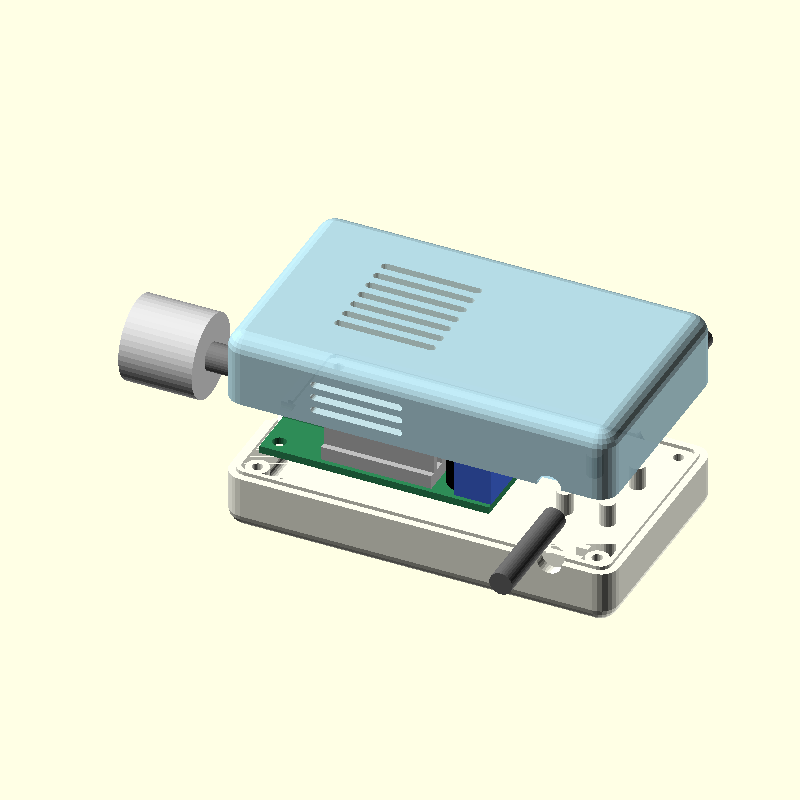

# 我的 3D 打印作品

收集自己设计、打印和验证过的 3D 打印作品。这里是后续 3D 打印模型、打印文件、预览图和说明的维护入口；原仓库保留作历史来源。

## 作品总索引

| 类别 | 项目与用途 | 项目 README | 缩略图 | 原仓库 |
|---|---|---|---|---|
| 卫浴 | 洗手盆下水管转接件：连接两种外丝、带连续过渡和梅花握持纹 | [打开](works/bathroom/sink-drain-adapter/README.md) |  | — |
| 光学 / 收纳 | 角膜塑形镜清洁套装盒：铰链、锁扣和清洁收纳结构 | [打开](works/optics/orthokeratology-lens-cleaning-kit-box/README.md) |  | [原仓库](https://github.com/Norman-w/OrthokeratologyLensCleaningKitBox) |
| 健康 / 设备保护 | 理疗仪线缆串联保护盒：保护控制板、线缆出线和散热区域 | [打开](works/health/therapy-cable-inline-box/README.md) |  | [原仓库](https://github.com/Norman-w/therapy-cable-inline-box-for-physio) |

> 收录标准：优先收录体量较小、生活中直接使用、以 3D 打印件为主体的作品。大型体育设备、复杂机构、电路和完整业务工程保留在原仓库，不进入这里。智能拖挂房车项目也保持在原仓库。

## 目录

```text
works/<作品名>/      作品源文件、打印文件、预览和验证记录
templates/work/     新作品模板
scripts/             工具脚本
```

每个作品至少记录：用途、尺寸、配套实物、`.scad` 源文件、STL / 3MF、预览图、验证结果、打印参数和未完成项。

## 状态

`concept` → `digital-verified` → `sliced` → `printed` → `assembled` → `accepted`

数字模型通过、切片成功或网页预览，都不等于实物装配验收。

## 新建作品

```sh
sh scripts/new-work.sh my-object
```

纯链接版索引：[`works/catalog.md`](works/catalog.md)
