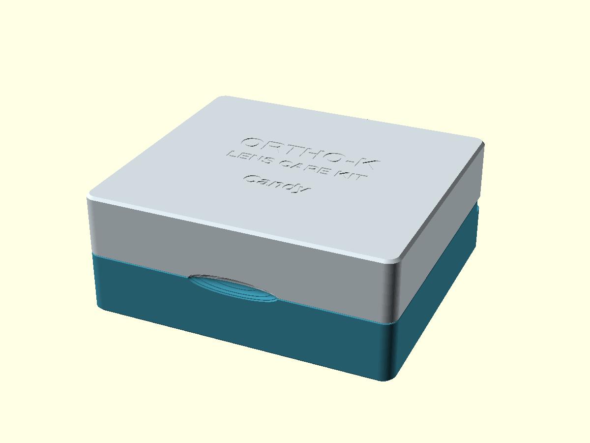

# 角膜塑形镜清洁套装盒 · Rev H Candy 署名版



[OpenSCAD 源文件](orthokeratology_lens_cleaning_kit_box.scad) · [V 形主 STL](output/3d-print/orthokeratology_lens_cleaning_kit_box_print_in_place_open.stl) · [铰链试片](output/3d-print/orthokeratology_lens_cleaning_kit_box_hinge_coupon.stl) · [机械验证报告](output/validation/mechanics.json)

按用户要求取消水密结构：**无密封槽、无硅胶条、普通壁厚 2.4 mm、顶底各 2.0 mm**。完整矩形净空仍为 **130 × 100 × 50 mm**。隐藏锁扣、后轴遮盖、前侧开口防滑指槽、外壳倒角及同盘原位打印均保留。

顶盖外侧三行居中凹刻 **ORTHO-K / LENS CARE KIT / Candy**，从前侧开口方向看文字为正向。用途文字采用 Liberation Sans Bold，Candy 采用 Bold Italic；字体随 OpenSCAD 安装包提供。刻深 0.4 mm，文字下方仍留 1.6 mm 连续顶板；不凸出、不改变外包络或机构。字形已固化进所有含顶盖的 STL，无需打印机安装字体；0.4 mm 喷嘴切片时仍需检查小字笔画是否保留。

| 项目 | mm |
|---|---|
| STL 量块验证的完整矩形净空 | 130 × 100 × 50 |
| 上 / 下净深 | 25 / 25 |
| 闭合外形，含所有机构 | 134.8 × 121.8 × 54 |
| 普通壁厚 / 顶底板厚 | 2.4 / 2.0 |
| 开口指槽 | 宽约 40、上下合计高约 8、内凹深 4 |
| 顶底倒角 / 分型外缘倒角 | 1.2 / 0.35 |
| 主 STL 包络 | 134.80 × 202.81 × 111.20 |
| 主打印姿态 | 开口 90°、两半各倾斜 45°的 V 形 |

实体体积从 Rev F 的约 293,555 mm³ 降到约 143,229 mm³，减少 **51.2%**。这是 STL 几何实体体积比较，**不是切片后的耗材重量或打印时长**；支撑、brim 和填充尚未计入。

## 机械结构与受力路径

单位 mm，FDM / X1C / 0.4 mm 喷嘴，暂按未填充 PETG。中间分型面 z=27。无螺钉、嵌件或另装销；两个被铰链捕获的活动实体一起打印。

普通左右壁及前后减料区外壁为 2.4 mm。前后结构区不再整条实心：内侧减料区直接连通内腔，不产生封闭空洞或跨越两支座的长顶桥。两处锁扣包络深 11.4 mm、两处轴根支座包络深 10.4 mm，**这些是局部机构区，不是整圈壁厚**。负载由短卡齿支臂 / 轴叉经各自局部支座传到底板和相邻外壁；不侵入 130×100×50 净空。前侧中间指槽顶部留到 Y=5.2 mm 的局部背部加强，并以斜面过渡。

两片内部弹片宽 12、厚 1.6，梁长 23.8，其中根部连接 2、自由段约 21.8 mm。根部桥约 3 mm、卡齿侧支承 6.1 mm、推杆悬伸 2.5 mm，保留上一版缩短悬空件的设计。

前壁按压区是 0.8 mm 连续薄壁，背腔约 24×20.5 mm；外侧没有裸露弹片或贯穿按钮缝。按压点距左侧约 35 / 99.8 mm、距底面约 13.5 mm，推杆向内约 1.5 mm 推开锁钩后，扣住中央开口指槽抬盖。弹性手感、回弹、疲劳及薄壳整体挠曲均待实物验证，没有强度或寿命保证。

销轴直径 3.6、轴孔直径 4.3、轴套外径 6.4，轴向间隙 0.35 mm；孔心偏置 0.15 mm。实际轴心 Y=117.6、Z=27 mm。轴叉从前方生根，后侧保留外壳遮盖，运动接缝约 1.3 mm。几何工作范围检查为 0–100°，不要强掰到 180°。

## 已取消水密要求

周边密封槽、密封条装配和压缩量要求全部移除。上下壳普通口沿合拢，依靠前扣锁定、后轴定位；不用于盛水，不承诺防水或防泼溅等级。STL 报告里的 watertight 仅表示三角网格闭合，不代表盒子水密。它是清洁套装外壳，不替代原厂镜片护理盒。

## 构建与验证

需要 Python 3、Node.js 和支持 `--backend=CGAL` 的 OpenSCAD。脚本优先使用环境变量 `OPENSCAD_BIN`，其次查找 PATH 中的 `openscad`，最后尝试 macOS 默认安装路径。验证所用 Python 依赖列在 scripts/requirements-validation.txt；不需要私人 Codex 技能目录。

权威源文件为 orthokeratology_lens_cleaning_kit_box.scad。网页尺寸、壁厚、板厚和动画轴心通过服务读取 SCAD 参数，不再在动画中写死旧轴心。

```sh
python3 -m venv .venv
.venv/bin/pip install -r scripts/requirements-validation.txt
./scripts/validate.sh
./scripts/render_previews.sh
./scripts/render_views.sh
```

output/3d-print/ 保持稳定文件名：

- orthokeratology_lens_cleaning_kit_box_print_in_place_open.stl：V 形主文件。两半开口 90°、各倾斜 45°，不是平铺 180°。
- ..._hinge_coupon.stl：铰链局部试片，先验证间隙、支撑移除和释放转动；不代替锁扣测试。
- ..._closed_preview.stl / ..._open90.stl / ..._section.stl：外观、底座平放开盖、剖面检查。
- ..._base.stl / ..._lid.stl：真实分件审查和动画使用，不是拆开打印再组装的备用件。

CGAL 导出后检查：闭合网格、连通件数量、完整净空量块、实际侧壁 / 板厚探针、无残留侧边密封槽、内部减料区、前壁薄膜、后轴遮盖、闭合碰撞、0–100° 每 2° 的刚性开合扫描、推杆 0–1.5 mm 行程与卡齿支架间隙。报告在 output/validation/mechanics.json，弹片在未变形状态下的接触量另列。未进行弹性有限元、疲劳模拟或真实切片。

仓库内置拓扑检查并生成每个 STL 的报告。主打印文件和铰链试片要求零面积三角面为 0；辅助闭合 / 分件 / 剖面视图中 CGAL 可能产生共线三角面，报告单独列出计数，但仍必须满足无重复顶点面、闭合边拓扑和一致绕序。辅助视图不作为独立打印文件。

`node --test scripts/test_motion.cjs` 检查动画共享坐标变换、轴心和 0° / 90° 包络与 OpenSCAD 导出的一致性。网页播放、暂停、角度拖动不改变打印文件。

## X1C 首件边界

暂定 0.20 mm 层高、4–5 道墙。检查 2.0 mm 顶底板和 2.4 mm 壁的实际切片路径；V 形斜置不能只凭顶底层数判断实心厚度。1:1 导入，保留 V 形和两个捕获实体，不拆开自动摆盘，不合并活动间隙。两条倒角窄边贴板需要 brim，并检查首层稳定性。

**仍不承诺免支撑**：销轴桥接约 6.7 mm，短推杆、卡齿及轴附近仍要逐层检查起始悬空点。活动轴孔内禁止填支撑，按钮背腔不要生成无法取出的密集支撑。STL 不携带机器配置、材料参数或支撑绘制。本次没有实际切片或发起打印；减薄后的刚度和卡扣手感要用首件确认。

## 局域网预览与开合动画

```sh
python3 serve.py --host 0.0.0.0 --port 8766
```

启动后打开 [本机预览](http://localhost:8766/)，同一可信局域网的其他设备使用服务器电脑的局域网 IP 和端口 8766。仓库不自动安装后台服务。网页默认「开合动画」：点击播放往返 0–100°，可暂停、拖角度、直接开闭；蓝色底座固定，浅色盒盖绕实际轴心运动，镜头范围固定。不模拟弹片解锁变形。默认不自动播放；切换模型、离开页面或开启减少动态效果时暂停。

主文件 / 试片可下载；在动画、闭合、剖面和分件视图下载或打开切片器，仍提供 V 形主 STL，不会误发闭合模型。局域网直发需要先在 X1C 配置中切好单盘 .gcode.3mf，STL 不能直接打印。

打印机连接需要 IP、序列号和 LAN Access Code；凭据仅在请求内存中或忽略提交的 bambu.local.json 中使用。未安装 Bambu Studio 时下载 STL 自行切片。局域网页面没有账号系统，仅用于可信同网；本次没有发送打印任务。

仓库仅保留用于减料比较的厚壁 Rev F 基线：archive/rev-f-sealed/，不是当前打印交付。更早的错误 / 废弃原型、临时验证 STL、运行日志、虚拟环境、实际打印机凭据及上传的打印任务均不纳入公开仓库。
