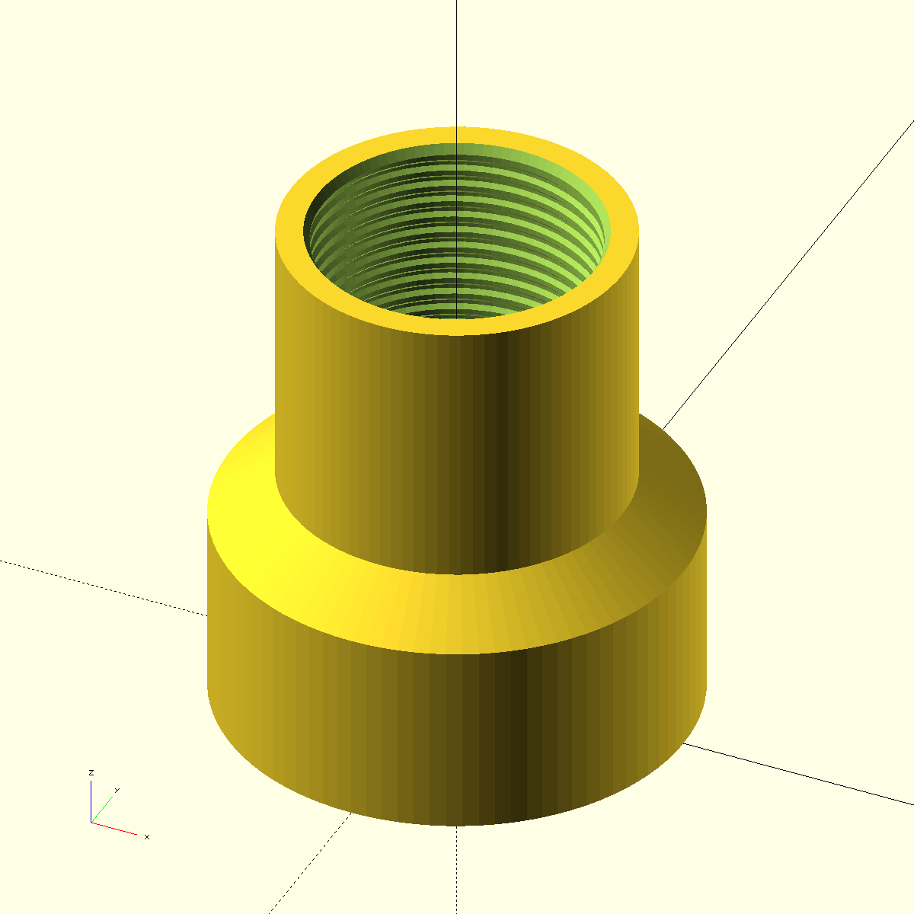
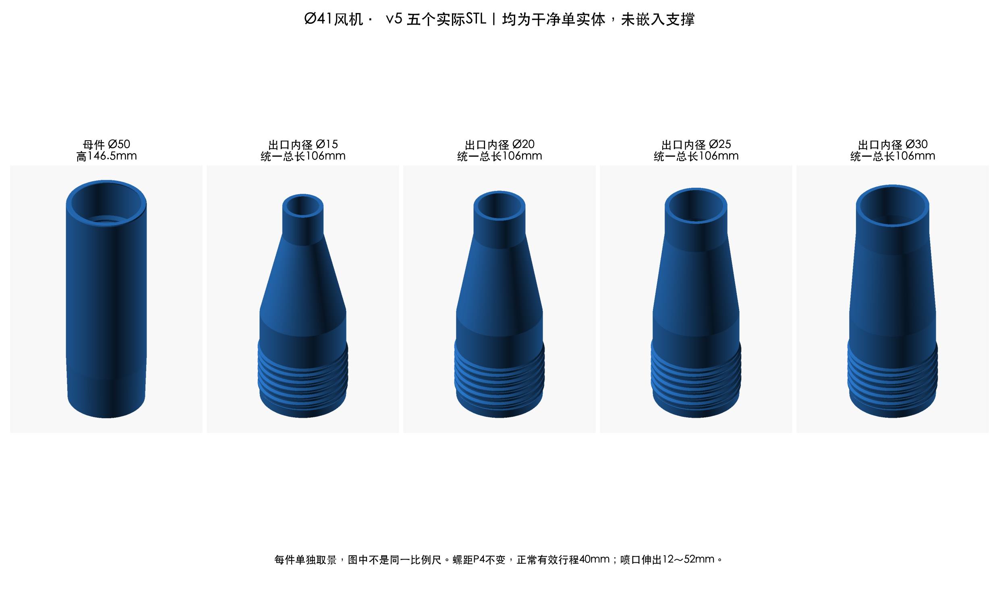
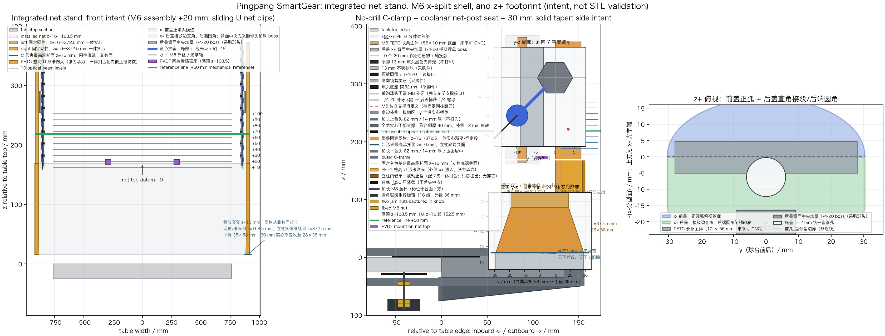
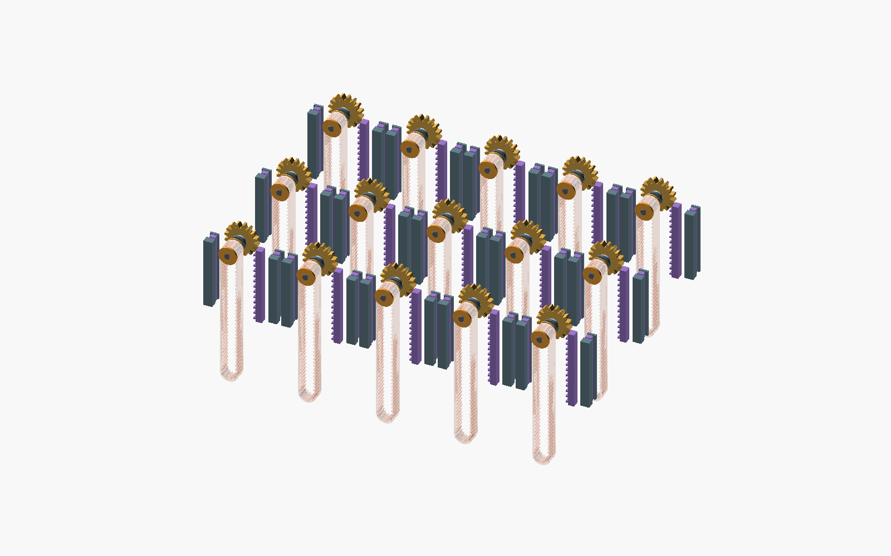
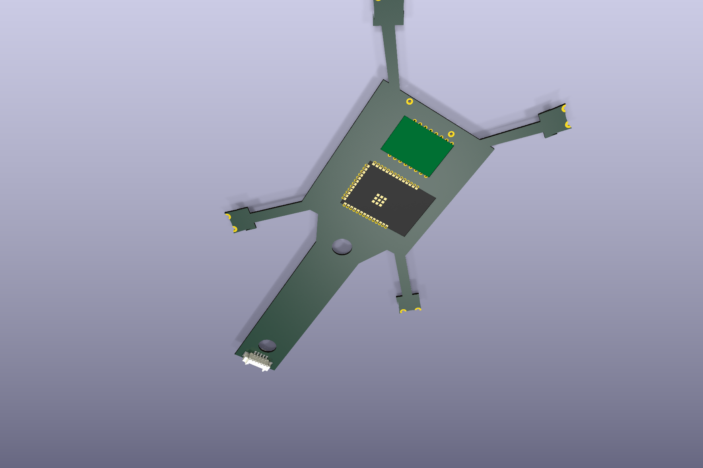

# 我的 3D 打印作品

收集自己设计、打印和验证过的 3D 打印作品。这里是后续 3D 打印模型、打印文件、预览图和说明的维护入口；原仓库保留作历史来源。

## 作品总索引

| 类别 | 项目与用途 | 项目 README | 缩略图 | 原仓库 |
|---|---|---|---|---|
| 卫浴 | 洗手盆下水管转接件：连接两种外丝、带连续过渡和梅花握持纹 | [打开](works/bathroom/sink-drain-adapter/README.md) |  | — |
| 光学 / 收纳 | 角膜塑形镜清洁套装盒：铰链、锁扣和清洁收纳结构 | [打开](works/optics/orthokeratology-lens-cleaning-kit-box/README.md) |  | [原仓库](https://github.com/Norman-w/OrthokeratologyLensCleaningKitBox) |
| 乒乓球 | 机械点射与可调旋转改装：送料、风机、旋转头和电动版结构研究 | [打开](works/table-tennis/bernoulli-launcher-parts/README.md) |  | [原仓库](https://github.com/Norman-w/Pingpang-BernoulliLauncherParts) |
| 乒乓球 | 乒乓智配：球网支架、传感器、激光夹座和配套打印件 | [打开](works/table-tennis/smart-gear/README.md) |  | [原仓库](https://github.com/Norman-w/pingpang-smartgear) |
| 工作台 | 智能零件抽屉：抽屉机构、链条传动、离合和电机驱动结构 | [打开](works/workshop/smart-parts-drawer/README.md) |  | [原仓库](https://github.com/Norman-w/SmartPartsDrawer) |
| 乒乓球 | 智能乒乓球拍：外壳、尾部接口、电源和 PCB 装配结构 | [打开](works/table-tennis/smart-paddle/README.md) |  | [原仓库](https://github.com/Norman-w/SmartPaddle) |

> 迁移说明：项目通过 `git subtree` 保留原仓库已提交历史，并复制了原工作区中未被 Git 忽略的当前文件。虚拟环境、缓存、本机凭据和切片任务等忽略文件不进入公开仓库。智能拖挂房车项目保持在原仓库，没有迁入这里。

## 目录

```text
works/<作品名>/      作品源文件、打印文件、预览和验证记录
templates/work/     新作品模板
scripts/             工具脚本
```

每个作品至少记录：用途、尺寸、配套实物、`.scad` 源文件、STL / 3MF、预览图、验证结果、打印参数和未完成项。

## 状态

`concept` → `digital-verified` → `sliced` → `printed` → `assembled` → `accepted`

数字模型通过、切片成功或网页预览，都不等于实物装配验收。

## 新建作品

```sh
sh scripts/new-work.sh my-object
```

纯链接版索引：[`works/catalog.md`](works/catalog.md)
