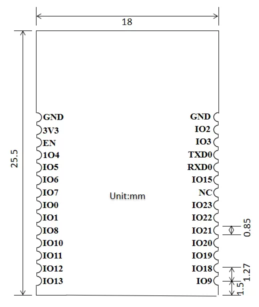
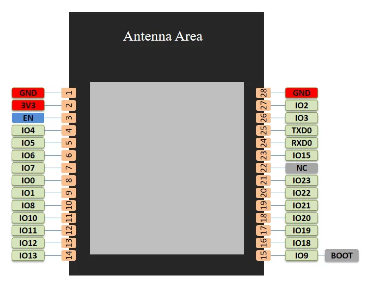
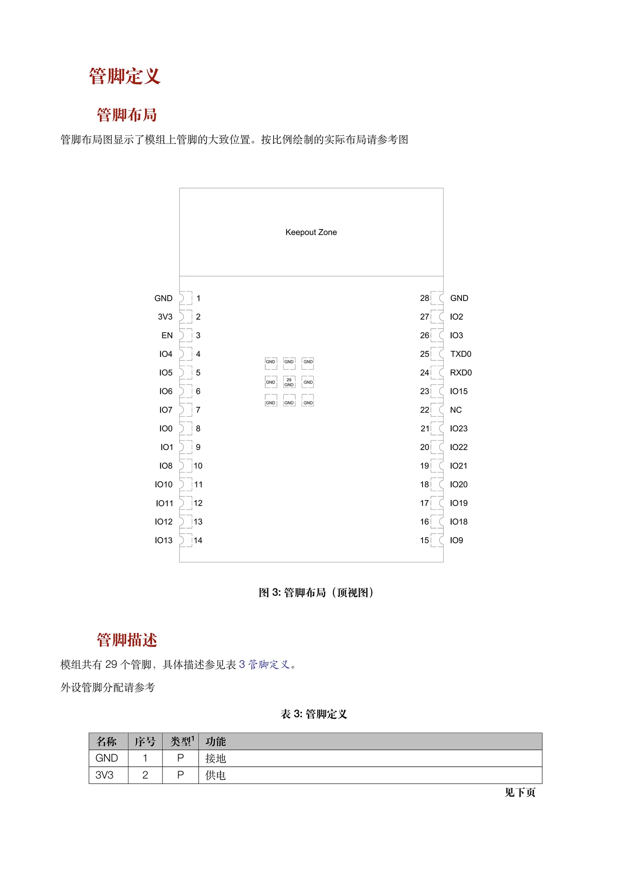

# ESP32-C6-N8 引脚与外形（商品图）

来源：商家商品描述图（见同目录 `images/`）。与乐鑫 ESP32-C6-WROOM-1 半孔定义一致。





## 外形（装配 / 开窗）

| 项目 | 数值 | 备注 |
|------|------|------|
| 本体 | **18.0 × 25.5 mm** | 与 `V1_BRINGUP_ISSUES` / footprint 目标一致 |
| 半孔节距 | **1.27 mm** | |
| 半孔开口宽 | **0.85 mm** | footprint 应用 Ø0.85 |
| 端边 → 首孔中心 | **1.5 mm** | V1 曾偏约 0.5 mm，改板必核 |
| 天线区 | 短边一端（图示上方） | 板设计约定天线朝 **−X** |

## 编号约定（顶视 = 元件面朝上、天线在上）

- **左侧 pin 1 → 14**（天线端 → 远端）：自上而下  
- **右侧 pin 15 → 28**（远端 → 天线端）：自下而上（天线端右侧为 pin 28）
- 旋到板坐标 **天线 −X** 后：**pin1–14 = +Y（拍柄）**，**pin15–28 = −Y（拍头/IMU）**
- **禁止**按模块背面（无元件面）丝印直接抄坐标——会上下两排对调（旧 mod 即此错误）



## 半孔 → 信号（项目常用列）

> **机器可读真理源：** [`pcb/lib/esp32c6n8/pinmap.py`](../../pcb/lib/esp32c6n8/pinmap.py)  
> 下表与 pinmap 同步；改绑定只改 pinmap，再 `generate_sgfk_esp32c6n8_mod.py` + `validate_esp32c6n8_pinmap.py`。

| Pad | 丝印 | 芯片功能（摘要） | SmartPaddle 用法（`main.ato` / `config.h`） | 朝向（顶视） |
|-----|------|------------------|---------------------------------------------|--------------|
| 1 | GND | GND | GND | 拍柄 (+Y) |
| 2 | 3V3 | 3.3 V | VCC_3V3 | 拍柄 |
| 3 | EN | CHIP_EN（低复位） | EN + 10k 上拉；宽栈道 SW_EN | 拍柄 |
| 4 | IO4 | GPIO4（strapping） | IMU UART1 TX | 拍柄 |
| 5 | IO5 | GPIO5（strapping） | IMU UART1 RX | 拍柄 |
| 6 | IO6 | GPIO6 | PZT BL | 拍柄 |
| 7 | IO7 | GPIO7 | PZT BR | 拍柄 |
| 8 | IO0 | GPIO0 | （未用） | 拍柄 |
| 9 | IO1 | GPIO1 | （未用） | 拍柄 |
| 10 | IO8 | GPIO8（strapping / LED） | WS2812 DATA | 拍柄 |
| 11 | IO10 | GPIO10 | **PWR_LATCH** | 拍柄 |
| 12 | IO11 | GPIO11 | （未用） | 拍柄 |
| 13 | IO12 | USB_D− | USB_DN | 拍柄 |
| 14 | IO13 | USB_D+ | USB_DP | 拍柄 |
| 15 | IO9 | GPIO9 **BOOT**（strapping） | SW_BOOT / 恢复出厂 | 拍头/IMU (−Y) |
| 16 | IO18 | GPIO18 | **USER_BTN**（尾键） | 拍头/IMU |
| 17–21 | IO19–23 | GPIO | （未用） | 拍头/IMU |
| 22 | NC | — | — | 拍头/IMU |
| 23 | IO15 | GPIO15（strapping） | （未用） | 拍头/IMU |
| 24 | RXD0 | U0RXD / GPIO17 | 尾插 / 调试 UART RX | 拍头/IMU |
| 25 | TXD0 | U0TXD / GPIO16 | 尾插 / 调试 UART TX | 拍头/IMU |
| 26 | IO3 | GPIO3 | PZT TR | 拍头/IMU |
| 27 | IO2 | GPIO2 | PZT TL | 拍头/IMU |
| 28 | GND | GND | GND | 拍头/IMU |
| 29 | EPAD | GND | 底板接地 | — |

完整功能表扫描件：[`images/pin-function-table.png`](images/pin-function-table.png)

## Strapping（与启动/复位相关）

上电采样相关脚（勿在复位边沿被外设强拉到错误电平）：

| 脚 | 模块 pad | 板上连接注意 |
|----|----------|--------------|
| EN | 3 | 必须有上拉；勿与 IO 短路 |
| GPIO9 / BOOT | 15 | 下载时拉低；运行时宜高/悬空上拉 |
| GPIO8 | 10 | LED 数据；复位瞬间勿被强驱错 |
| GPIO4 / GPIO5 | 4 / 5 | **当前接 IMU UART**；也是 strapping |
| GPIO15 | 23 | 未用，保持悬空即可 |

## 固件 GPIO 速查（`firmware/main/config.h`）

```
PWR_LATCH  = GPIO10  (pad 11)
USER_BTN   = GPIO18  (pad 16)
BOOT       = GPIO9   (pad 15)
LED        = GPIO8   (pad 10)
IMU TX/RX  = GPIO4/5 (pad 4/5)  UART1
PZT        = GPIO2/3/6/7
Console    = UART0 = TXD0/RXD0 (pad 25/24)
```

模块内部简图：[`images/module-schematic.png`](images/module-schematic.png)
