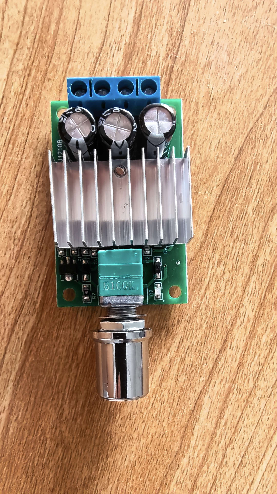
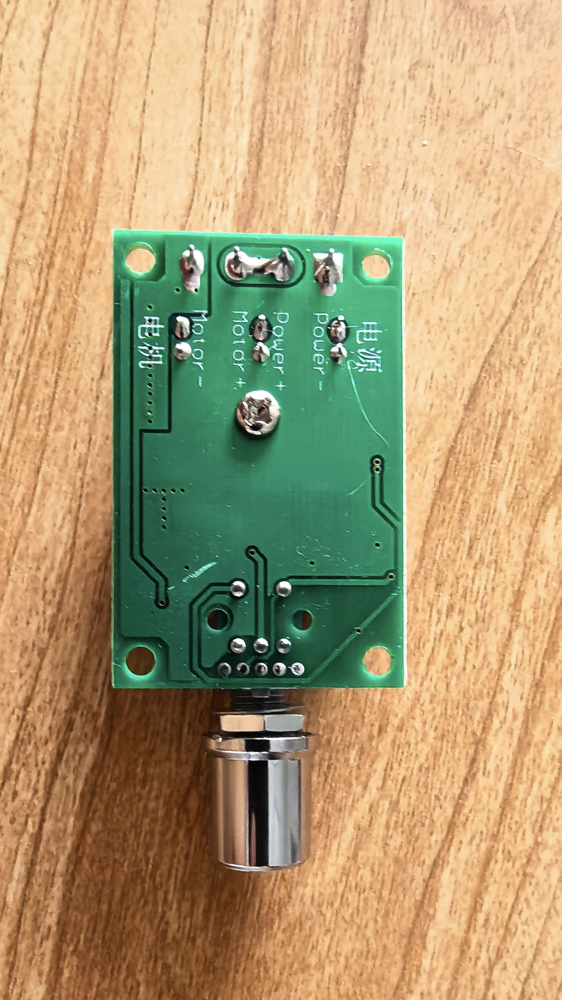
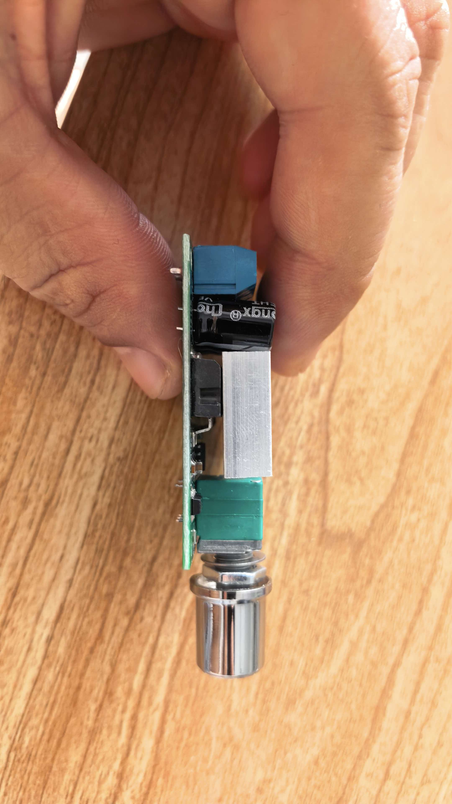
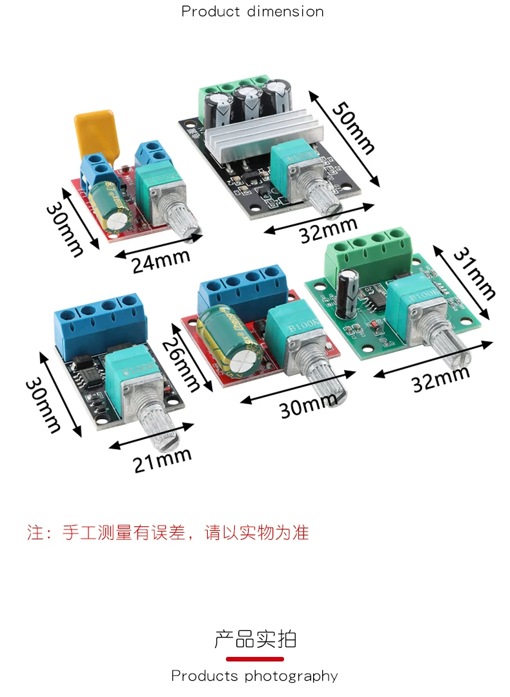

# DC Motor Speed Controller V03（功率输出版）

这是当前准备装入线缆串联盒的新版调速主板。它取代
[`../synairy-esc-adaptor-v02/`](../synairy-esc-adaptor-v02/) 中仅输出 PWM
控制信号的 V02 板。

## 当前已知信息

| 项目 | 当前信息 | 状态 |
|------|----------|------|
| 主板外形 | 暂按 **50 × 32 × 1.6 mm** | 长宽来自商品图，厚度暂定 |
| 功率接线 | 4 位端子：`Motor−`、`Motor+`、`Power+`、`Power−` | 由 PCB 背面丝印确认 |
| 调节方式 | B100K 电位器，旋钮轴从 PCB 短边伸出 | 照片确认 |
| 功率器件 | 带铝散热片 | 照片确认；壳体需要考虑散热和安全间距 |
| 安装 | PCB 四角孔约 ⌀**3 mm**，孔心距相邻板边约 **3 mm** | 用户实测 |
| PCB 安装螺丝 | 4× **M2×5 mm 沉头螺丝** + `flat.stl` 附带的 4×打印承压垫圈，锁入下壳 ⌀**1.7 mm** 底孔 | 防止沉头嵌压约 ⌀3 mm PCB 平孔；这批螺丝不能用于合盖 |
| 壳体合盖螺丝 | 4× **M2×16 mm 沉头螺丝**（M2×18 mm 也可） | 从底面穿过下壳后锁入上盖导孔柱 |
| 旋钮套筒 | 外螺纹约 ⌀**6.5 mm** | 用户实测 |
| 旋钮轴线 | PCB 正面以上约 **6.2 mm** | 用户实测 |
| 当前壳体 XY | 内腔 **80×44 mm**；名义外形 **84.8×48.8 mm** | 接线端单侧加长 12 mm，侧壁加厚至 2.4 mm |
| PCB 定位 | ⌀7 mm 主 Boss + ⌀2.8→2.6×1.4 mm 导入定位颈 + ⌀1.7 mm M2 底孔 | 适配约 ⌀3 mm PCB 孔；垫圈只承压，不代替定位 |
| 线缆限位 | ⌀3.5 mm 双柱，柱间净宽 **5.8 mm** | 适配当前 5.0 mm 线缆并留 0.8 mm 装配余量 |

> 商品图注明“手工测量有误差，请以实物为准”。壳体开孔、罗马柱和
> 元器件净空不得只按照片比例定稿，待测项目见 [`dimensions.md`](dimensions.md)。

## 壳体方向

新版采用十字布局：PCB/盒体的 **50 mm 长方向与线缆方向垂直**。
旋钮从一个短端伸出，四位端子位于相反一端；两段线缆分别从端子附近的
左右侧壁进入。接线端一侧额外增加 12 mm，使 PCB/端子到最近线缆限位柱
保留约 10.6 mm 净空，便于剥线、转弯、接线和维护，同时避开旋钮和散热片。

## 实物照片

### 正面

### 背面与端子丝印

### 侧面高度与旋钮组件

### 商品尺寸图

## 文件索引

| 文件 | 内容 |
|------|------|
| [`dimensions.md`](dimensions.md) | SCAD 建模所需尺寸、坐标约定和待测清单 |
| [`images/01-front.jpg`](images/01-front.jpg) | 主板正面实拍 |
| [`images/02-back.jpg`](images/02-back.jpg) | 主板背面实拍、接线丝印 |
| [`images/03-side.jpg`](images/03-side.jpg) | 主板侧面实拍 |
| [`images/04-product-dimensions.png`](images/04-product-dimensions.png) | 商品尺寸参考图 |

## 安全边界

该板属于通用直流电机调速器，不因装入外壳而自动具备医疗电气安全、
患者隔离或失效限流能力。用于理疗设备前，仍需独立确认工作电压、电流、
波形、隔离及单故障条件下的安全性。
