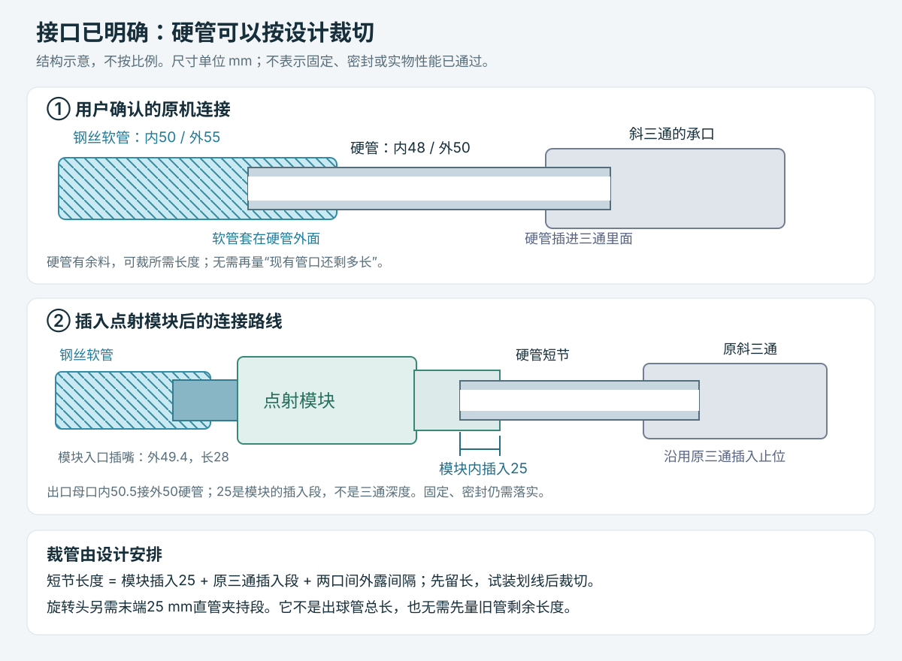

> 历史设计子报告：当前33件送料总装、材料、裁管安排和装配数量已由 [本版统一装配说明](final-assembly.md) 接替。本文旧数量和未集成状态保留用于追溯，不作为当前制作清单。

# 已确认的原机接口与裁管安排

用户于 2026-09-24 补充：内径48、外径50 mm的硬管有余料，可以按需要裁切；硬管插进斜三通承口，内径50、外径55 mm的钢丝软管套在硬管外面。**原机的连接关系和硬管可裁切条件已经明确，不再要求用户先量一个既有的“管口夹持直段”，也不再询问软管套内还是套外。**

用户随后确认硬管是**透明PC**。原机已组装，原供电风力不足；用户回忆最早那台设备为21 V，当时将可调电源设到42 V后能发球，现已拆解，当时电流不记得。只有最早风机已确认无调速功能，后来三个已购商品的具体套餐已由订单核实，实物型号、额定参数和调速能力仍待核实。21/42 V不视为核实铭牌或设计供电，详见[现有硬件](current-hardware.md)。这些事实不改变已给定的48/50和50/55接口尺寸。

## 当前采用的最小改装路线

`钢丝软管 → 打印模块入口插嘴 → 点射模块 → 硬管短节 → 原斜三通`

软管侧直接套在当前模块的打印入口插嘴上；三通侧保留用户原来的50外径硬管作为短节。短节一端进入模块母口，另一端按原来的方式插回三通。这样无需按未知三通外形定制一个抱住三通的壳体。入口、出口现有名义几何因此无需倒换或改径，但固定、密封和实际配合仍未定型。

| 连接 | 当前候选尺寸及含义 |
|---|---|
| 软管 → 模块入口 | 插嘴外径49.4、浅环最大49.8、长28 mm；配用户内径50软管，箍紧和气密待验证 |
| 模块出口 → 硬管短节 | 母口内径50.5、设计插入25 mm；配用户外径50硬管，单边名义间隙0.25 mm |
| 硬管短节 → 斜三通 | 保留原硬管实际插入止位和原连接方式，不把25 mm当成三通承口深度 |
| 出球管 → 旋转头 | 旋转头目前设计套入/夹持25 mm直管；裁管时为它留出这一段，不需要量现有剩余长度 |

尺寸仍以 `cad/parameters.scad` 为几何来源。旧变量名 `y_stub_od=50` 在当前接口契约中对应**硬管外径**；`y_stub_engagement=25` 对应**模块母口的设计插入段**。它们不表示三通外径或三通承口深度。`barrel_engagement=25` 对应旋转头的夹持段，和前述模块母口是两个不同位置。

## 怎么裁，而不是再量一遍所有接口

短节所需长度为：

`25 mm模块插入段 + 原三通实际插入段 + 两口之间的外露间隔`

先用余料留长，按原插入痕迹或原止位将一端装入三通；另一端按模块母口25 mm插入段划线，结合机构与风机/软管的避让确定外露间隔，再裁切、去毛刺。这里的划线裁管是正常装配步骤，不要求用户现在提供一个精确的三通承口深度。外露间隔不是固定为零：须留出拆装空间，也不能靠短节顶住两端端面承受扳机力。

出球管的总长不等于25 mm。25 mm仅是旋转头套住的末端直管段；总长还包含原三通插入段、出球段和整机避让。已有长管可以继续使用，需要短管时再按整机位置裁切。

## 设计仍需负责的连接问题

- 50.5母口套50硬管是有间隙的插接，插入25 mm本身不等于已抗拔、抗转或气密。需落实独立固定与密封；不能靠继续拧紧合壳螺钉、破坏X=0硬止挡来夹管。
- 软管入口的箍紧、钢丝螺旋处漏气和抗拔仍需具体设计与实测。当前打印插嘴比原50外径硬管略小，不能因原管能接软管就继承其密封结论。
- 模块自重、扣动扳机和软管拖拽的载荷不能默认全部由短节与三通的摩擦承担。硬管壁厚只有1 mm，也不能通过压瘪管壁消除间隙。
- 现有入口从内径50软管进入45.4打印通径，入口导入圆角/倒角尚需细化；修改时要连同端部浅储胶槽检查。出口45.4通径进入硬管内径48为顺流扩径，但切口仍须去毛刺。

本次关闭的是原机接口定义和裁管自由度的疑问。完整机构公差、接头固定/密封、弹簧和实物单发/旋转验证仍开放，不把用户补充尺寸当作实物验收通过。

出口新增的[装配剖面研究](interface-study.md)采用一体化阶梯分体箍、带肩内衬和一对 M3 螺钉，保留原母口。研究中1.5 mm内衬肩会把硬管有效插深减为23.5 mm；这尚未替代上表的基线25 mm母口。胶只作非结构密封，抗拔、压紧量、薄壁强度和承载支架未完成，不据此提前裁定短节总长。
