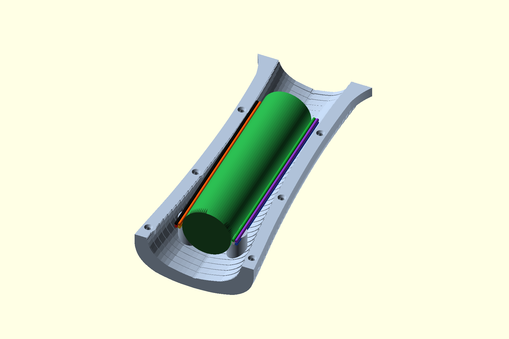
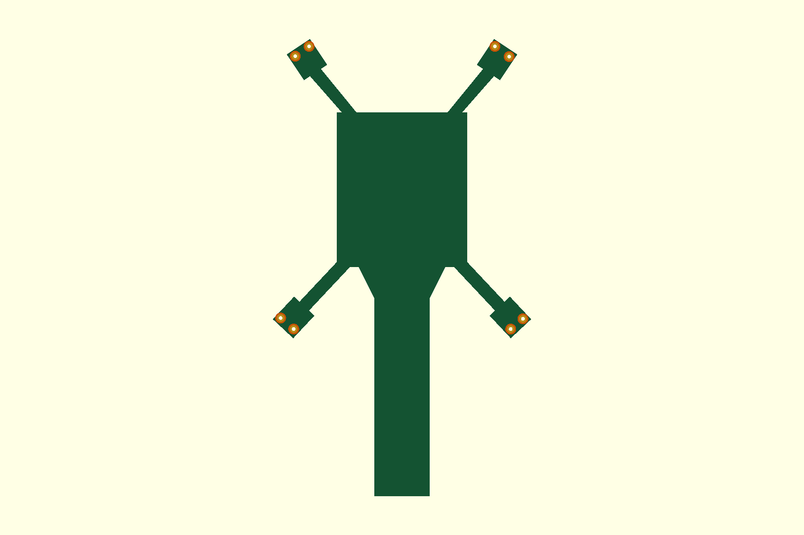

# M7.C5 布线前机械与射频交接

本目录保存当前方案真正参与建模和门禁的机械契约；版本号只写在说明内，文件名和脚本名不派生版本特例。OpenSCAD 直接读取 [`mechanical-contract.scad`](mechanical-contract.scad)，`scripts/validate_mechanical_handoff.py` 再从当前 KiCad 主板逐项反证坐标和尺寸。

## 已锁定实物输入

- 电池：带端部圆形保护板的 14500；保护板不超过电芯直径，整件相对 50 mm 电芯增加不超过 2 mm。因此最大实物包络为 **Ø14.0 × 52.0 mm**，装配避让为 Ø14.3 × 52.5 mm，轴线沿拍柄 Y，中心 `[0,-138,0]`。这是保护电芯本身；尾板仍负责充电、升压和限流，但不应再被描述为裸电芯保护板。
- 线束：两条 MX1.25 4P 成品线，每条四芯均为 **UL1571 28 AWG、7×0.12 mm 镀锡铜、外径约 0.9 mm、尾端上锡 3 mm**。每束按 2×2 排列，在电池左右各留 2.0×2.0 mm 通道；本次不为弯曲半径附加空间。
- PZT：四个码头共 8 个线焊盘。现 PCB 每个 land Ø2.5、孔 Ø1.2；壳体让位严格以 8 个实际圆孔圆心为中心，做 Ø3.5 mm 局部凹位，并在原 PCB 槽基础上向两面各加深 0.5 mm。

解析当前贝塞尔截面后，原内腔不能完整容纳 Ø14 mm 电芯；局部电池凹位会扩大内腔，但最薄外壁仍约 **2.32 mm**，未把拍柄整体加粗。左右线槽经过离散螺柱时只保留小型原型余量，因此首件打印仍须用真实电芯和两束线做合壳试装；允许局部修槽后灌柔性胶，但不能切进尾板环槽或压迫电芯保护板。

## 诊断预览（非制造物）

上图直接使用当前贝塞尔拍柄后半壳、合同坐标和实物包络；绿色为 Ø14×52 mm 最大电池，左右彩色圆线为两束 4×Ø0.9 mm 导线。它用于看相对位置，不替代首件合壳测试。

绿色为当前刚性主板外形，金色为 Ø2.5/Ø1.2 mm 线焊盘，橙色外圈为 Ø3.5 mm 壳体让位包络。八个圆心由当前 KiCad 读取并受自动门禁约束。

## 主板调试键

`SW_BOOT`、`SW_EN`、`SW_PWR` 已统一为 Omron `B3U-1000P` / KiCad `Button_Switch_SMD:SW_SPST_B3U-1000P`，三只都标记 **DNP**。它们只在裸板测试时选择性手焊；正式装配不焊、外壳不开孔。尺寸和 footprint 证据沿用 [`../tail-user-switch-b3u-1000p/`](../tail-user-switch-b3u-1000p/) 归档的 Omron PDF 与 KiCad 9 stock 文件。

## ESP32-S3 天线边界

模块继续镶嵌在主板开窗内、天线朝 `−X`。footprint 内置名为 `ESP32_ANTENNA_HOST_KEEP_OUT` 的双面规则区：总包络为局部 `X[-18.0,-5.7] / Y[-10.0,10.0]`，即当前全局 `X[-21.0,-8.7] / Y[-11.0,9.0]`；靠 pad 1/40 的两角按焊盘外缘退到局部 X=-6.3、Y=±8.6，避免规则区误禁模块自身必需的两个 GND 焊盘。其余区域禁止 F.Cu/B.Cu 走线、过孔、焊盘、铺铜和其它封装。

Espressif 的理想建议是模块天线伸出基板，无法伸出时在周围留空，并在终端产品上验证吞吐和距离；其外壳建议净空量级达到 15 mm。当前嵌入式大陆区无法满足完整 15 mm，所以上述规则区是**当前板能实现的最大受控区，不等于官方 15 mm 合规**。外壳天线邻域必须保持非金属 PETG、不得放碳纤维/金属片；量产前必须在完整装配状态做 Wi‑Fi RSSI、吞吐和最远使用距离对比。官方依据：[ESP32-S3 Hardware Design Guidelines – PCB Layout Design](https://docs.espressif.com/projects/esp-hardware-design-guidelines/zh_CN/latest/esp32s3/pcb-layout-design.html)。

## 布线者必须保持

1. 不得在 `ESP32_ANTENNA_HOST_KEEP_OUT` 内画任何铜或放器件。
2. TPS62162 的 `SW` 铜岛、L1 和输入/输出电容按现位姿最短闭环；不要从天线侧绕行。
3. 两束线在拍柄电池段分别走 `−X/+X`；不得跨电芯、螺柱、尾板卡槽或保护板边缘。
4. PZT 线从圆孔焊盘离开时利用 Ø3.5 mm 凹位，不得让焊锡凸点成为合壳受力点。
