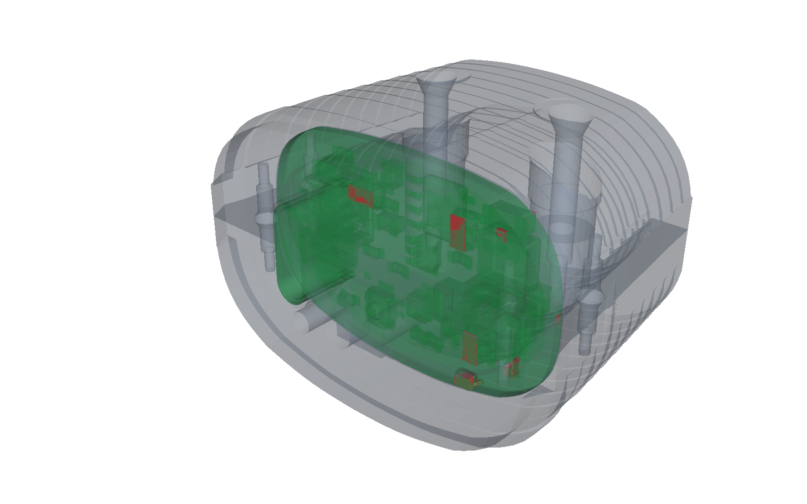
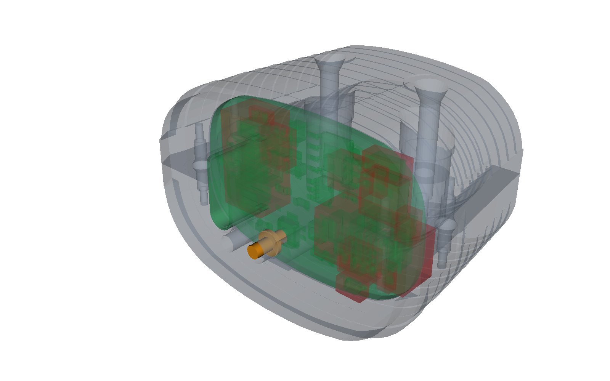
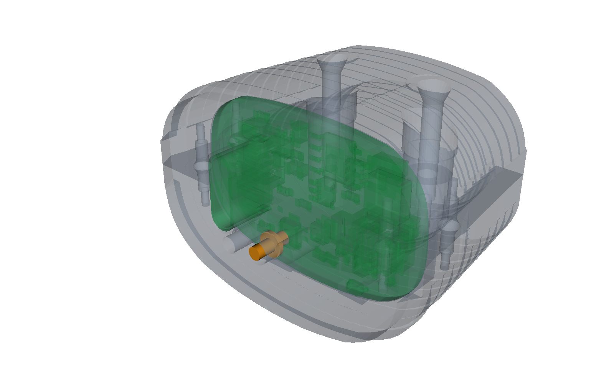

# 尾板与 M6 拍柄尾部 3D 干涉审计

状态（2026-08-15）：已用当前 `pcb-tail/layouts/default/default.kicad_pcb` 的完整 KiCad 3D 装配，与当前 Step6 拍柄尾部壳体做实体布尔相交。拍尾底平面本身不会挡住 USB-C J1 或 SW1；原壳体存在 12 处局部环槽/侧壁干涉，加入按 KiCad courtyard 生成的小避让后，完整装配交集降为约 `4.97e-08mm³`，可视为布尔数值噪声。

## 检查方法与坐标

- KiCad CLI 将当前尾板导出为临时 STEP；检查在 `/private/tmp` 的隔离副本中完成，没有打开或操作用户 KiCad UI。
- STEP 导出到拍柄坐标的实测变换为：`handle_x = step_x`、`handle_y = pcb_y + board_thickness - step_z`、`handle_z = -step_y`。这与参数化源中 KiCad 2D 到拍柄的映射一致，但额外计入了 STEP 导出对板坐标 Y 的翻转。
- 壳体、KiCad 整板、单独 J1/SW1、板槽、按键柱均做了实体交集；最终打印分件另做 watertight/winding 一致性检查。
- J4 的库模型为 WRL，KiCad STEP 未带出；另按官方最大包络 `4.2×4.3×1.4mm`、当前旋转与位置做保守盒体复核，交集为 0。

## 底平面与接口结论

- 拍尾底平面坐标为 `Y=-178.09617mm`；完整 J1 最外点约为 `Y=-178.09117mm`，名义上向壳内收约 `0.005mm`，且与 USB 开口交集为 0。
- SW1 本体、板槽与拍尾底平面均无实体相交；按钮中心与现有开孔中心一致。
- `0.005mm` 只代表 CAD 名义几何，不能覆盖打印收缩、连接器外壳和焊接高度公差。首个实物尾段仍应试装，确认 USB 插头能无应力完全插入；这不是 PCB 网络或板框错误。

## 原局部碰壳与修正

原壳体的真实交集均位于环槽/侧壁，不是拍尾底平面堵住接口：

| 器件 | 原交集体积 mm³ | 器件 | 原交集体积 mm³ |
| --- | ---: | --- | ---: |
| C6 | 3.422571 | J3 | 2.222981 |
| D2 | 1.905589 | C9 | 0.686294 |
| J2 | 0.528491 | U5 | 0.232235 |
| U2 | 0.232235 | U4 | 0.232235 |
| R9 | 0.170714 | R5 | 0.057615 |
| L1 | 0.035320 | C7 | 0.002032 |

合计约 `9.73mm³`。`pcb-tail/scripts/export_tail_interference.py` 现在从这 12 个器件的当前 courtyard、所在铜面和保守器件高度生成局部包络；`scripts/step6_tail_board_interfere_handle.py` 只切这些小包络，不扩大整段公共内腔。最终完整 KiCad 3D 装配与壳体交集约 `4.97e-08mm³`；J1、SW1、J4 保守包络和板槽分别为 0。

### 修正前

### 局部避让包络

### 修正后

## 按键访问与防脱推杆

基准方案是 SW1 执行头中心的 **Ø2.0mm 直通针孔**，可直接用针尖、笔尖或细棒按下，不依赖额外零件或未验证的打印行程。

另保留一只可选推杆：Ø1.6mm 轴、内侧 Ø3.0×0.5mm 法兰；壳内有 Ø3.4mm、深 0.8mm 的法兰窝。从壳内装入后，法兰阻止其向外掉出，装好的尾板/SW1 限制其向内迁移。拆下尾板时，应同时取出并收好推杆。

推杆名义静止间隙为 0.05mm、外露 0.30mm；它覆盖 B3U 的名义预行程，但尚未覆盖数据表 0.35mm 最大预行程的最坏组合。因此推杆是便利附件，批量采用前仍应打印尾段试片验证；针孔基准不受该试片状态影响。

## 文件与制造边界

- 机械事实：`enclosure/stl/interference/tail_interference.json`
- 自动生成的切除源：`enclosure/stl/interference/tail_board_cuts.scad`
- KiCad 事实导出：`pcb-tail/scripts/export_tail_interference.py`
- Step6 实体切除与可选推杆：`scripts/step6_tail_board_interfere_handle.py`
- 自动审计会锁定 12 个器件引用、当前位姿、针孔尺寸和防脱关系。

本次 3D 实体诊断只在临时目录生成 STL；没有覆盖仓库中用户当前的制造/预览 STL，也没有生成 Gerber、钻孔、BOM/CPL 或下单包。当前两块 PCB 仍处于无铜交接态，不能制造。
