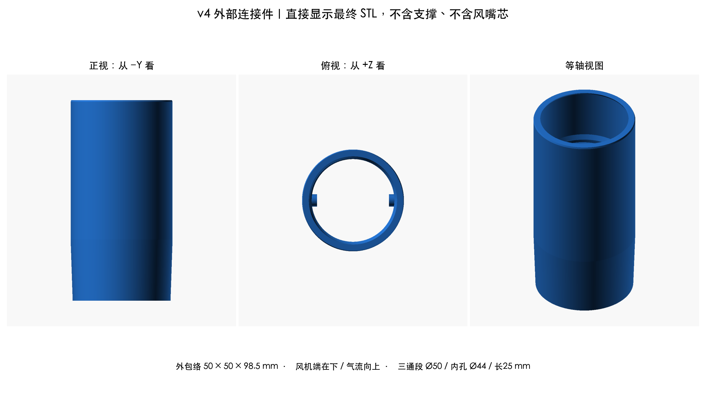
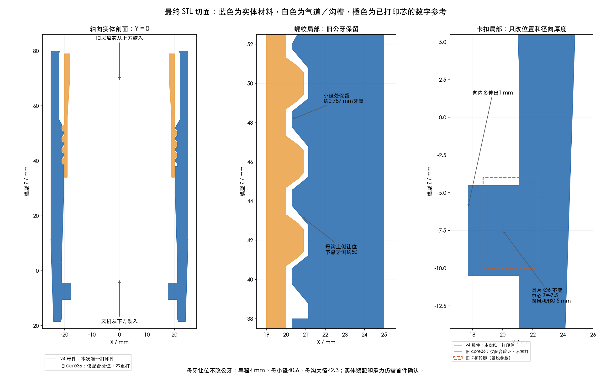
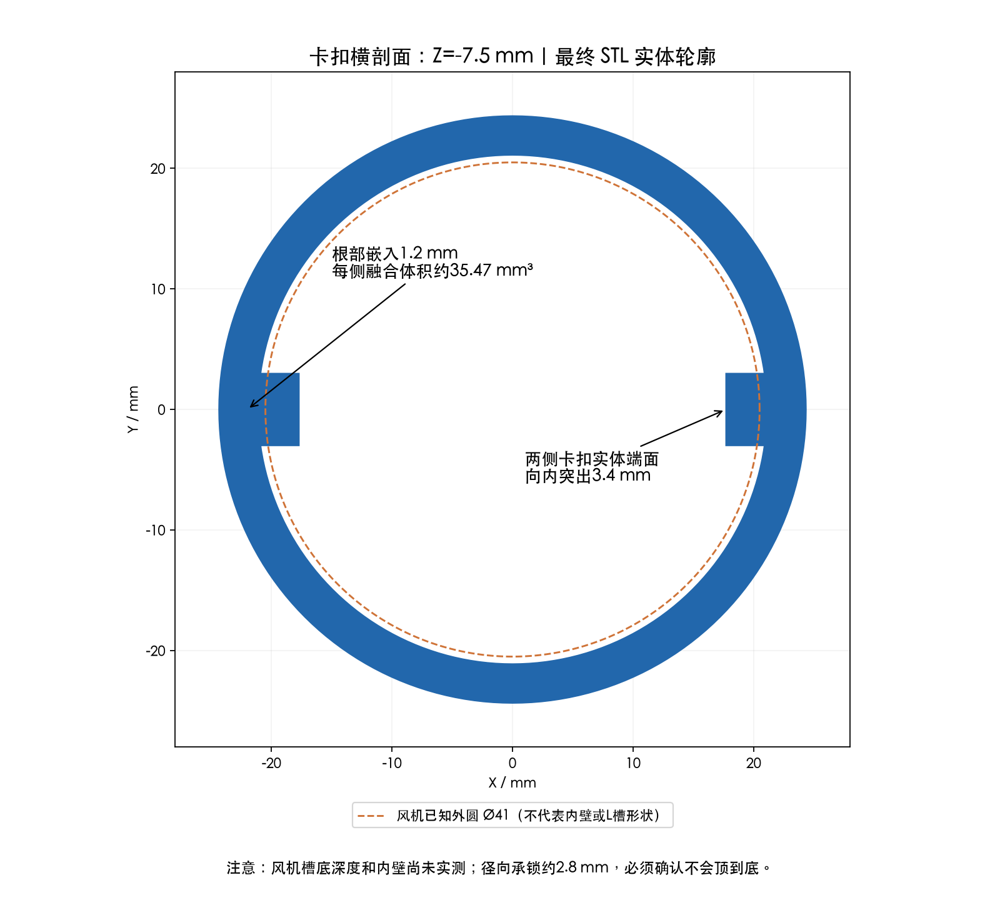

# Ø41 风机—Y 三通连接件 v4（几何交付）

唯一打印件：[fan-tee-v4-connector-clean.stl](stl/fan-tee-v4-connector-clean.stl)。不要把 `review/`、`verification/reference/` 的试验或参考网格加入打印板。模型未嵌入支撑、支撑块或 support enforcer。

尺寸 **50 × 50 × 98.5 mm**，模型 Z 范围 **-18.5…80 mm**，毫米制。推荐仍沿 +Z 立放，将模型 Z=-18.5 平面落床，即整体上移 18.5 mm；不要缩放。风机在下、三通在上。切片、设备准备及打印执行由主线程负责；本交付不证明已经打印。

## 按编号变更

1. 卡扣中心 **-7 → -7.5 mm**，向风机（-Z）移动0.5 mm。
2. 卡扣径向向内突出 **2.4 → 3.4 mm**。槽内圆片直径仍 **6 mm**，根嵌入仍 **1.2 mm**；不是将圆片直径扩大到7 mm。总径向圆柱长度由3.6变为4.6 mm。
3. 用户实测三通孔约 **50.2 mm**。插入段外径 **49.64 → 50.00 mm**，内径 **43.64 → 44.00 mm**，径向壁厚仍 **3 mm**。有效插入总长25 mm，其中恒定外径段24.2 mm，端部0.8 mm短倒角保留。名义单侧间隙0.1 mm，不等于已证明实际轻压配合。
4. 为兼容已经打印的公芯，只对母沟上侧增加让位。保持原公牙、导程4、母小径40.6、母沟大径42.3、公牙大径41.8、下牙侧和完整导入方向。母件下悬牙侧目标为相对水平50°，最终STL筛查最低49.86°。不通过关闭支撑或支撑屏蔽来冒充几何修正。

母牙小径处的轴向实体厚度由 **1.12 → 约0.787 mm**，径向咬合量仍0.6 mm，母沟底到外壁仍3.85 mm。这是换取更陡下悬面的明确代价；不声明扭矩、疲劳或实物强度已验证。公芯不用重做，但仍需实际旋入、退出和使用载荷检查。

## 验证证据

- `verification/parameter-diff.json`：全部共同参数的变更／保持清单。
- `verification/geometry.json`：最终STL测量；两侧圆片真实端面分别为Z=-10.5…-4.5、直径6，径向突出约3.4；每侧约35.47 mm³根部实体交集；整体一个封闭连通实体。
- `verification/downward-surfaces.json`：所有向下面检查，除落床底面外，低于水平45°的面只在卡扣；此报告不是实际切片支撑验收。
- `verification/motion-printed-core36.json`：冻结的旧实际core36 STL，408个姿态（直插及0.125 mm步长旋入，含半网格偏移），正确相位干涉体积0；0/4/8 mm调节位置的错转半圈反例都有干涉。
- `verification/motion-baseline-anchored-core36.json`：同样检查v3锚定牙型参考芯，408个姿态通过。该参考芯不打印。
- `verification/reference/printed-core-provenance.json`：旧core36文件SHA及历史来源。这里的旧路径仅用于溯源，不是运行时依赖。
- `verification/baseline-mesh-difference.json`：旧模型与新模型差异限定于卡扣、母沟屋顶和三通段；入口过渡区的差仅为浮点布尔误差。
- `verification/dependency-audit.json`：v4仅依赖自身三个CAD源，隔离重建复核；旧版目录可以由主线程安全归档后独立重建。
- `manifest.json`：打印目标、SHA、验收边界和文件清单。

旧core36的螺旋中心线局部锚点是5.44 mm；v3基准锚点是4 mm，因此两个参考件的数字初相位不同。旧芯在本母件坐入高度Z=34时匹配初相位129.6°；装配时手动寻找起牙位置即可，不需改旧公牙。完整变换关系和错相位对照都保存在各自报告。

## 实体图示







外观来自最终STL的原生深度缓冲渲染，没有透明叠加；剖面来自网格与平面的真实交线。橙色芯是验证参考，不是本次打印对象。

## 仍未通过的门槛

- 实际切片中仅卡扣局部树形支撑、支撑接触区与拆除通道：由主线程在 `print/` 审查，须同时看普通Support和Support interface。
- 风机槽底径向深度及内壁厚度尚未实测。卡扣跨过0.6 mm接口间隙后，名义承锁深度增加到2.8 mm，必须确认不会顶到底或撞内侧部件。
- 三通约50.2 mm只是用户实测近似值；仍需考虑锥度、椭圆度、PETG收缩、象脚以及实际插入深度。
- 卡扣的插入、转向、锁止、拆卸和承载循环；母牙变薄后的旋入手感、抗拉及振动工况。
- 数字STL闭合、相位通过和支撑筛查均不替代首件实配。

## 复现与文件边界

三个CAD源在 `source/` 自包含，可直接用OpenSCAD 2026.04.26导出；不需要任何v2/v3目录或外部SCAD库。`cad/` 下同名文件是工作源。

在具备 `numpy`、`trimesh`、`manifold3d`、`matplotlib` 的隔离Python环境中，从项目根目录执行：

```sh
python scripts/export_fan_tee_v4.py
python scripts/verify_fan_tee_v4.py
python scripts/render_fan_tee_v4_review.py
python scripts/finalize_fan_tee_v4.py
```

导出器的拓扑复核调用本机已安装的 `openscad-stl-print/scripts/inspect_stl.py`，可用 `--skill-dir` 指定技能位置；CAD本身不依赖该技能文件。旧core36的验证见证已冻结在本包内部，默认复验不会读取旧版目录。源或网格有任何变化都必须重新验几何和切片，不能沿用先前的视觉验收记录。

`print/`、`verification/retirement.json`、`scripts/prepare_fan_tee_v4_print.py` 和 `scripts/verify_fan_tee_v4_print.py` 属于主线程，本几何工作不覆盖它们。没有删除旧版、改技能库、提交/推送或操作打印机。
