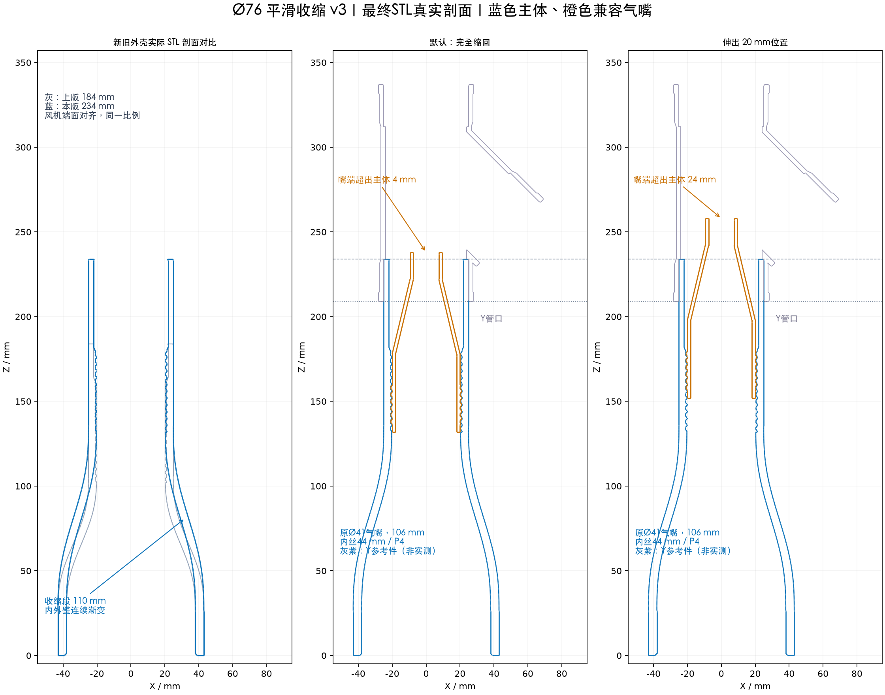

# Ø76 长缓收缩 v3（2026-10-08，几何审查版）

本次按用户要求进一步加长、放缓收缩，并将默认气嘴退回。允许增加主体总长和缩短调节范围；不改Ø41 v5气嘴、不扩大螺距。**仅交付干净STL及预览：未切片、未发送打印、未验证实物流量。导流件/膛线选型仍待决定，当前为光滑基础壳。**

## 尺寸变化

| 项目（mm，角度除外） | 上版v2 | 本版v3 |
| --- | ---: | ---: |
| 主体总长 | 184 | 234 |
| 收缩段轴向长度 | 80 | 110 |
| 收缩段最大壁面倾角（相对轴线） | 22.54° | 16.79° |
| 母牙名义区间长度 | 56 | 44 |
| 机构有效调节行程 | 32 | 20 |
| P4调节圈数 | 8 | 5 |
| 缩回时嘴端超出主体插入端 | 24 | 4 |
| 伸出极限嘴端超出主体插入端 | 56 | 24 |
| 风机出口端面到Y承口入口（参考） | 135 | 185 |

嘴端默认超出的4 mm以**主体Ø50插入端的末端**为基准，不是以Y管口为基准。按当前25 mm承口深度参考模型，从Y管口到嘴端为默认29、最大49 mm；真实承口止挡/交汇位置待实测，不能把机构行程当成已验收的通球范围。



## 装配、打印与螺纹契约

- mm / +Z出风 / X1C、0.4喷嘴、PETG候选；主体风机套口朝下立印，尺寸86×86×234，尚需本版原生切片与首层/支撑复核。没有嵌入支撑块，也没有新锁紧结构。
- 风机从Z0沿+Z插入，双矩形凸耳卡槽和18°卡接转角沿用v2。套口最小对边内径76（192边顶点直径约76.010仅为离散补偿），为用户指定的零设计直径间隙，仍须考虑PETG收缩后试装。
- 收缩Z26..136，共110 mm；内外轮廓沿`S(t)=10t³−15t⁴+6t⁵`变化，两端一、二阶导数为0。没有使用缩放旧网格、径向台阶或只有边接触的拼接。
- 气嘴从Y侧沿−Z先直插、再旋入。母小径40.6、母沟大径42.3、入口最窄43.3；原公牙大径41.8可以通过全入口，母牙仍保留实体咬合而非扩大成光孔。螺纹P4、牙高0.9、平顶0.8、原上下牙侧约50°相对水平不变。
- 母丝名义Z136..180，完整切沟延伸至Z132..184；入口导向从Z182至末端。气嘴基准Z132..152，角度为`360*(z+4−136)/4`；两个工作极限均有4个完整承力圈。工作范围不是物理硬止挡，勿任意越程。
- 载荷路径仍为公牙→配对母牙→连续外壳→卡槽顶。母沟处径向壁厚3.85；Ø50/Ø44插入段壁厚3、长25，端头0.8短倒角，适配用户实测约Ø50.2承口。
- 原气嘴入口2 mm唇边及原直段/锥段连接保留，因此只是**外壳收缩段更柔和**；不可宣称各个调节位置整个气路都无台阶、无扰流或已经优化风量。
- 后续支撑仍由切片器生成和检查：卡槽顶可达、支撑可拆、不得非预期接触牙面。当前没有v3 G-code或3MF，旧打印包不能替代。

## 文件与数字验证

- `stl/fan76-smooth-v3-body-clean.stl`：新外壳。
- `stl/fan-tee-v5-nozzle{15,20,25,30}-clean.stl`：四个原Ø41 v5气嘴逐字节复制；已有这些气嘴无需重打。
- `source/`、`verification/parameters.json`、`verification/export.json`：冻结源、实际求值尺寸与STL哈希。
- `verification/summary.json`：数字几何通过，明确未切片/未实物验收。主体及四个气嘴均为封闭正体积单体，包围盒及牙面法向检查通过。
- 每个气嘴604个位姿覆盖完整直插、旋入及两端附近，实体交集均为0；半圈错相位反例交集约477..487 mm³。风机直插、旋转和0.5轴向游隙通过，硬拔/过转/越过卡槽顶能检出干涉。
- `render/front.png`、`top.png`、`iso.png`、`assembly-section-iso.png`：直接渲染最终STL；剖面对比同样来自网格平面交线，不是概念图。

上述检查是有限采样和参数约束，不能替代打印收缩、卡接拉拔、旋入手感、通球试验或实测风量。本次没有操作打印机。

## 预览与复现

[同一8877局域网预览](http://192.168.7.187:8877/fan-nozzle/#fan76-direct)。首次载入v3会忽略旧壳记录的行程/阶段，回到0 mm（嘴端超出4 mm），保留气嘴选择、相机及公共状态；之后v3内的Tab切换/刷新仍记忆位置。Ø41几何、原打印文件和独立位置记忆不变。

脚本文件名沿用v2以兼容已有命令，本版必须指定`--revision 3`。需要OpenSCAD和Python的numpy/trimesh/manifold3d/matplotlib；本机现有CAD环境可用，但临时环境路径不作为长期依赖保证。

```sh
python scripts/build_fan76_smooth_v2.py --revision 3
python scripts/verify_fan76_smooth_v2.py --revision 3
python scripts/render_fan76_smooth_v2.py --revision 3
python3 scripts/publish_fan_nozzle_preview.py
node scripts/test_fan_nozzle_preview.mjs http://192.168.7.187:8877/fan-nozzle/
python3 scripts/test_fan_nozzle_print_package.py
```

原v1、v2与Ø41冻结包保留；不覆盖其网格或借用其切片/机器状态。五次曲线的参考出处和未做CFD的边界沿用[v2设计说明](../fan76-smooth-v2-20261008/README.md#流动设计依据与待决项)，此处倾角改变量由本版几何公式计算，不作为性能测量。
