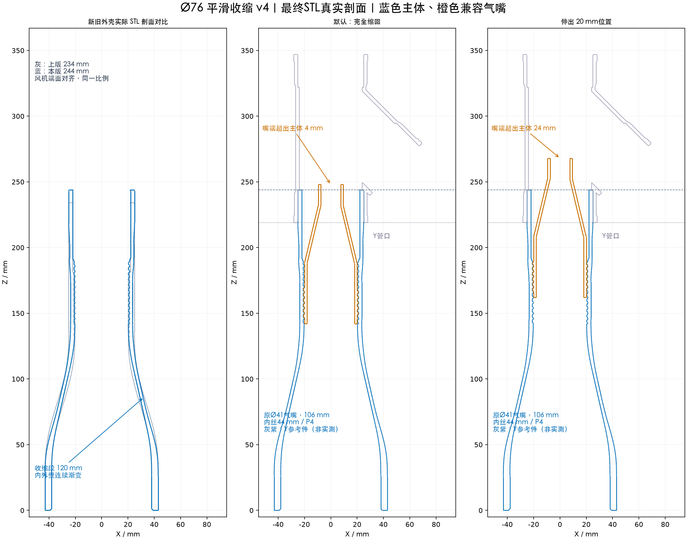

# Ø76 薄壁缓收缩 v4（2026-10-08）

本版同时处理“收缩还不够柔和”和“外壳太厚、打印太久”。减薄非配合壁面，保留原风机卡槽和三通插接尺寸；Ø41 v5四个气嘴逐字节复用。**完成数字几何检查和单主体离线试切对比，未放行或发送打印。** 导流件/膛线型式仍待用户选择，当前是光滑基础壳；没有添加涡轮、锁紧件或嵌入式支撑。

## 尺寸与壁厚

| 项目（mm，角度除外） | 上版v3 | 本版v4 |
| --- | ---: | ---: |
| 主体总长 | 234 | 244 |
| 收缩段长度 | 110 | 120 |
| 收缩内壁最大倾角（相对轴线） | 16.79° | 12.79° |
| 收缩薄壁区径向名义厚度 | 约4.7–5 | 2.4 |
| 母沟底剩余径向厚度 | 3.85 | 2.4 |
| 三通插接段外径 / 内径 / 壁厚 | 50 / 44 / 3 | 50 / 44 / 3 |
| 母牙名义长度 / P4有效行程 | 44 / 20 | 44 / 20 |
| 嘴端超出主体插入端（缩回 / 伸出） | 4 / 24 | 4 / 24 |

风机端原卡槽区域保持不变，未开槽处径向壁厚约5 mm；向薄壁区逐渐减薄，而不是把整件统一削成2.4。母牙外壳OD47.1，导向区OD48.8，再平滑变为Ø50插接段。插接段长25 mm；短端部倒角沿用原尺寸。

名义2.4 mm指径向厚度，不是各处曲面法向最小厚度或已验证的强度承诺。实际STL以8个截面、两侧径向、0.5 mm轴向间距进行6960点采样，最小径向厚度约2.400 mm。承力路径仍为气嘴公牙→母牙→连续壳体→风机卡槽，未出现只有边/角接触的拼接。



## 更柔和的收缩与装配

- 收缩在Z26..146。不是简单拉长旧网格：以三次平滑斜率的积分构建轮廓，42 mm缓入、36 mm均匀收缩、42 mm缓出；四个衔接处保持C2连续，减少收缩集中在中段的情况。内外壁都检查单调连续。
- 套口名义最小对边ID76，192边离散补偿不作为额外配合余量；风机双凸耳卡槽及18°旋转沿用旧版。用户指定零设计间隙，PETG收缩后的实际试装仍必要。
- 气嘴从Y侧旋入。母小径40.6、沟大径42.3，公牙大径41.8，入口最窄43.3，P4、牙高0.9、平顶0.8及牙侧约50°相对水平全部保持。母丝名义Z146..190，切沟延伸Z142..194，导向始于Z192。
- 原106 mm气嘴基准Z142..162；全行程20 mm/5圈，两个极限均有4个完整承力圈。默认缩回时嘴端超出主体末端4 mm，最大24 mm。按25 mm参考承口深度，从Y管口量为29..49 mm；这不是实测通球安全范围。
- 原气嘴入口2 mm唇边及直段/锥段交界保留。因此只确认外壳收缩更柔和，不能声称整条气路在任意调节位置都无台阶、无扰流或风量更大；没有进行CFD或风量实测。

## 单主体打印耗时对比

同一已保存原生预设快照：Bambu Studio 02.08.02.61、X1C/0.4喷嘴、PETG、0.2 mm层高、25%填充、树形自动支撑、风机套口朝下立印；每盘仅一个外壳。没有为分析文件添加模型内支撑块。

| 模型 / 墙数 | 估算时间 | 估算耗材 |
| --- | ---: | ---: |
| v3 / 4圈 | 5小时47分09秒 | 192.02 g |
| v4 / 4圈 | 5小时17分41秒 | 165.75 g |
| v4 / 3圈（仅对照） | 5小时12分53秒 | 153.06 g |

本版采用**减薄模型、保留4圈墙**的方案：比v3省约29分28秒（8.5%）及26.26 g（13.7%）。再减到3圈仅额外省约4分49秒，故暂未作为默认。上述为切片器单主体估算，不是整套用量、实际打印耗时或强度验收；模型实体体积变化不能代替这些切片结果。

CLI使用临时独立配置目录，未更改桌面软件账号、语言、打印机连接；分析导出前后核对原生启动/结束G-code保持不变。未连接或发送到打印机。自动树形支撑的接触面、卡槽可拆支撑、牙面无误支撑仍需正式切片预览检查；分析3MF/G-code明确标记为**NOT_FOR_PRINT**，不是打印发布文件。

## 文件和验证证据

- `stl/fan76-smooth-v4-body-clean.stl`：新的干净外壳，86×86×244 mm。已有四个Ø41 v5气嘴无需重打。
- `stl/fan-tee-v5-nozzle{15,20,25,30}-clean.stl`：与Ø41冻结包字节完全相同。
- `source/`与`verification/export.json`：冻结源、参数和网格哈希。`manifest.json`及几何审查的NOT_SLICED是几何阶段边界，不代表后续未进行离线估算。
- `verification/summary.json`、`mesh.json`：封闭正体积单体、尺寸、牙面法向；四个气嘴各604个位姿覆盖完整装入和工作行程，正确相位没有实体交集，错相位反例能检出干涉。
- `verification/wall-thickness.json`：实际网格壁厚采样；`profile-comparison.json`：曲线、体积及原卡槽区域差集比较。有限采样不替代制造公差/拉拔强度验证。
- `verification/slice-comparison.json`及`slice-estimate-*.json`：输入STL、切片器/预设/分析包哈希与离线估算；没有机器执行记录。
- `render/front.png`、`top.png`、`iso.png`、`assembly-section-iso.png`及上面的剖面对比直接来自最终STL，不是概念图。
- `analysis-slices/`保留在本机、被Git忽略；它们是未放行的对比中间件，不作为打印下载入口。

## 预览与复现

[原8877局域网预览](http://192.168.7.187:8877/fan-nozzle/#fan76-direct)。v4首次载入默认回到0 mm，保留气嘴和公共视角状态；同一版Tab切换/刷新继续记忆位置，Ø41及历史冻结打印包不变。

脚本名沿用v2以兼容既有命令，本版必须指定`--revision 4`。需要OpenSCAD、Python的numpy/trimesh/manifold3d/matplotlib；离线对比另需本机Bambu Studio及既有原生预设模板。未验证全新环境完整复跑。

```sh
python scripts/build_fan76_smooth_v2.py --revision 4
python scripts/verify_fan76_smooth_v2.py --revision 4
python scripts/render_fan76_smooth_v2.py --revision 4
python3 scripts/compare_fan76_smooth_v4_slices.py
python3 scripts/publish_fan_nozzle_preview.py
node scripts/test_fan_nozzle_preview.mjs http://192.168.7.187:8877/fan-nozzle/
python3 scripts/test_fan_nozzle_print_package.py
```

数字几何和离线估算完成后，仍需正式支撑/预设审核、PETG实际配合、卡接拉拔、密封、通球及风量试验。未执行这些验收，也没有发送打印。
