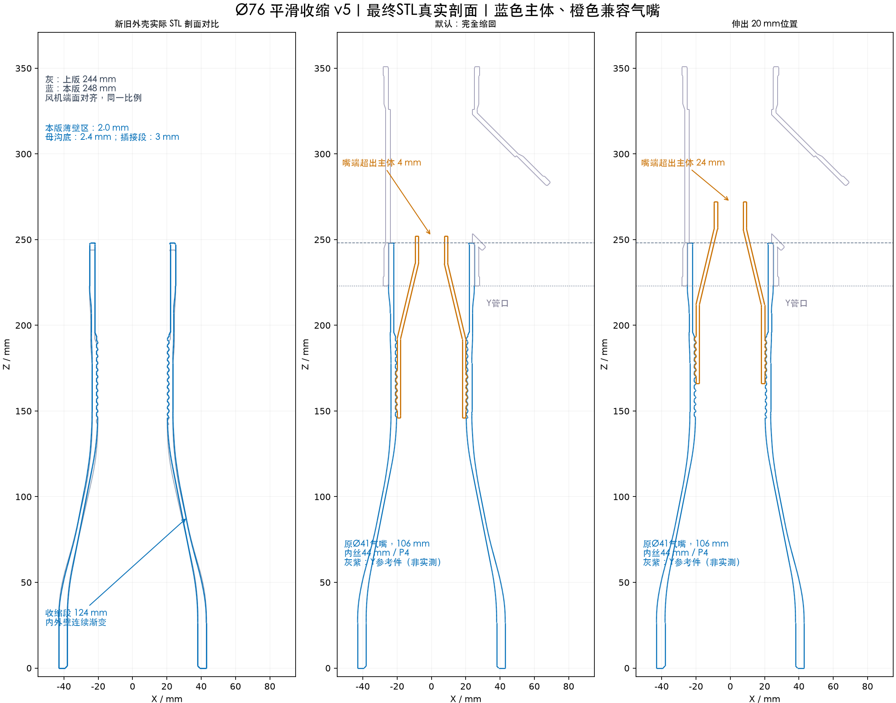

# Ø76 薄壁缓收缩 v5（2026-10-08）

按“再柔和一些、再薄一些”生成。保持Ø41 v5气嘴、P4、20 mm行程和两个安装接口；只修改Ø76外壳轮廓。**数字几何与离线估算已完成，没有发送打印；强度、实际配合、支撑接触和风量未验收。**

2026-10-08打印准备续记：已整理[单外壳准备工程与切片预检](print/README.md)，卡槽支撑及螺纹刀路检查通过，但CLI机型标识检查未通过，原生界面操作暂时超时；仍未放行、未发送。以下离线对比保留为设计阶段记录。

## 本次变化

| 项目 | v4 | v5 |
| --- | ---: | ---: |
| 主体总长 | 244 mm | 248 mm |
| 收缩段长度 | 120 mm | 124 mm |
| 内壁最大倾角（相对轴线） | 12.79° | 11.13° |
| 外壁最大倾角（相对轴线） | 16.23° | 15.00° |
| 收缩薄壁区径向名义厚度 | 2.4 mm | 2.0 mm |
| 非配合导向段壁厚 | 2.4 mm | 2.0 mm |
| 母螺纹沟底剩余径向厚度 | 2.4 mm | 2.4 mm |
| 三通插接段外径/内径/壁厚 | 50/44/3 mm | 不变 |

收缩段采用两次积分的缓变曲率轮廓：34 mm缓入、56 mm均匀收缩、34 mm缓出，各弧线衔接的解析设计达到C3连续。内外壁最大斜率、最大斜率变化率均低于v4，不只是拉伸旧网格。实际STL仍是离散三角网格，不把解析光滑度当作打印表面质量或流量证据。

风机卡槽区域与v4的实体差集为0；保留卡槽顶承力材料。收缩段从风机端厚壁平滑减薄到2.0，再在螺纹前平滑恢复承力厚度。母牙外壳OD47.1，非配合导向区OD48，再渐变至Ø50三通插接段；未添加台阶、支撑块或额外锁紧机构。受力路径仍为气嘴牙→配对母牙→连续壳体→风机卡槽。



## 接口与打印契约

- 单位mm；X1C/0.4喷嘴/PETG候选，风机套口向下立印。最终包围盒86×86×248 mm。当前冻结原生预设高度上限250 mm，模型余量2 mm；没有修改机器高度限制或软件账号/语言/连接。
- 套口名义最小对边ID76，192边离散补偿不计为配合间隙；风机沿+Z插入，双凸耳旋转18°卡接。零设计直径余量是用户指定值，仍需PETG首件实配。
- 原四个106 mm Ø41 v5气嘴按字节复制，出口15/20/25/30 mm；从Y侧沿−Z装入，再按P4旋入。母小径40.6、沟大径42.3、公牙大径41.8、入口最窄43.3、牙高0.9/平顶0.8不变。
- 收缩Z26..150；母丝名义Z150..194，切沟Z146..198，导向从Z196开始。气嘴基准Z146..166，行程20 mm/5圈；两端都保留4个完整承力圈。
- 默认嘴端超出主体Ø50端4 mm，最大24 mm；按25 mm参考承口深度，从Y管口量为29..49 mm，不是已验证的通球范围。三通交汇点/止挡深度尚未实测。
- 原气嘴入口2 mm唇边及直段/锥段交界不改；不宣称整条气路在所有位置均无台阶或无扰流。导流件/膛线型式仍待选择，没有添加涡轮；无CFD或实测风量结果。
- 名义壁厚指径向值，不是曲面法向厚度或强度保证。最终STL用8个截面、两侧、0.5 mm轴向间距的7088个样本检查，最小径向厚度约2.000 mm。无意外薄片/破壁。

## 离线试切结果（单外壳）

相同原生X1C/0.4/PETG/0.2 mm层高/4圈墙/25%填充/树形自动支撑；每盘仅一个外壳，不包含四个气嘴。独立临时CLI配置目录，未接触打印机。两次分析导出均确认原生启动和结束代码完整保留，未修改调平/进料逻辑。

| 本次重新试切 | 时间估算 | 耗材估算 |
| --- | ---: | ---: |
| v4 / 4圈墙 | 5小时17分45秒 | 165.75 g |
| v5 / 4圈墙 | 5小时20分59秒 | 159.78 g |

**耗材减少约5.97 g（3.6%），时间反而增加约3分14秒（1.0%）。** 加长和不同刀路抵消了薄壁的时间收益，本次是更柔和、减重版，不是进一步缩时版。模型实体体积减少3.87%，不把体积变化直接当作打印耗材/时间变化。分析文件未审核牙面/卡槽的实际支撑接触，不能直接作为打印发布。

## 文件与验证

- `stl/fan76-smooth-v5-body-clean.stl`是本版干净外壳。四个`fan-tee-v5-nozzle*-clean.stl`与原Ø41冻结包逐字节相同，已有气嘴不必重打。
- `verification/export.json`及`source/`记录源、实际求值参数、STL哈希；导出与几何报告中的NOT_SLICED只代表几何阶段，后续离线估算看`slice-comparison.json`。
- `verification/summary.json`、`mesh.json`及`motion-core*.json`：封闭正体积单体、包围盒、牙面法向；四个气嘴各604个位姿覆盖完整直插和螺旋装入路径，正确相位交集0，错相位反例能检出干涉。卡槽旋入、回拔/过转反例分别验证。
- `verification/curve-smoothness.json`：独立Python公式对照OpenSCAD采样，验证各接点以及内外壁斜率/斜率变化率；`wall-thickness.json`来自最终网格采样。
- `verification/slice-comparison.json`与`slice-estimate-*.json`记录本次估算、输入/切片器/配置/分析包哈希、250 mm预设上限、2 mm高度余量及启动/结束代码核对。不是机器执行状态。
- `render/`里的前/顶/等轴和装配剖面均由最终STL生成。`analysis-slices/`被Git忽略，文件标记NOT_FOR_PRINT，不是用户打印下载入口。

## 预览和复现

[原8877局域网预览](http://192.168.7.187:8877/fan-nozzle/#fan76-direct)已经使用v5。首次载入清除旧版本行程记录，默认0 mm；气嘴选择与公共视角保留。同版Tab切换继续记忆位置，Ø41不变。历史v1–v4文件不覆盖。

脚本沿用早期名称以兼容既有命令；本次须显式指定revision。需要现有OpenSCAD、Python numpy/trimesh/manifold3d/matplotlib及Bambu Studio/原生预设快照，未验证全新环境完整复跑。

```sh
python scripts/build_fan76_smooth_v2.py --revision 5
python scripts/audit_fan76_smooth_v5_profile.py
python scripts/verify_fan76_smooth_v2.py --revision 5
python scripts/render_fan76_smooth_v2.py --revision 5
python3 scripts/compare_fan76_smooth_v4_slices.py --revision 5
python3 scripts/publish_fan_nozzle_preview.py
node scripts/test_fan_nozzle_preview.mjs http://192.168.7.187:8877/fan-nozzle/
python3 scripts/test_fan_nozzle_print_package.py
```
