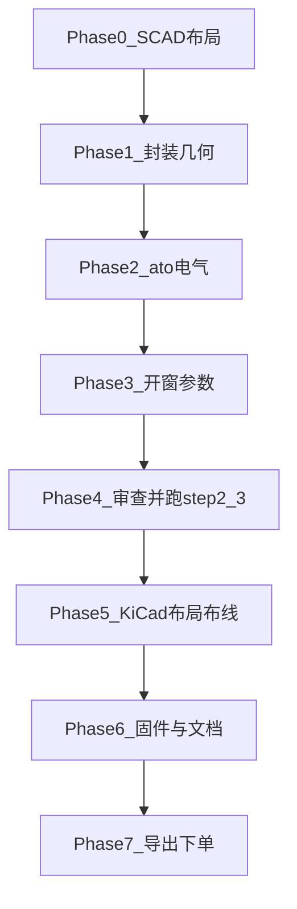
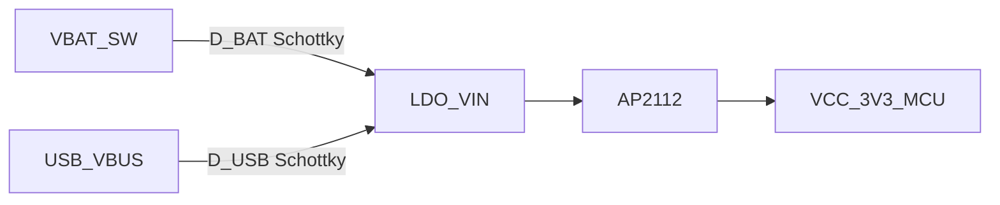

# V1 回板改板实施计划

依据：[pcb/V1_BRINGUP_ISSUES.md](pcb/V1_BRINGUP_ISSUES.md)、[pcb/README.md](pcb/README.md)、[enclosure/parameters.scad](enclosure/parameters.scad) / [enclosure/paddle_shell.scad](enclosure/paddle_shell.scad)。

**状态（2026-07）：** Phase 0–4 / 6 已完成；**仅剩 Phase 5 手布线 + DRC + 出板**。  
尾插为 **MX1.25 正反 5P**；下文若仍写「金手指 / TAIL_STIFF」视为历史，勿再执行。

## 多视角复查（结论摘要）

| 视角 | 发现 | 计划处置 |
|------|------|----------|
| 与清单一致性 | §7.1 仍写「默认不改 SCAD」，与 Phase0 冲突 | 实施前改 bring-up 文档（todo `sync-bringup-md`） |
| 机械/外壳 | 漏斗或加 Y 会改腔体外形 → 旧壳可能不再贴合 | Phase0 结束做「新旧轮廓叠加」；必要时重打壳或确认仅 PCB 内缩 |
| 机械间隙 | MCU 沿 **Y** 靠 IMU：主要风险是撞 IMU 开窗/半孔，**不是**天线 | Phase0 只约束 MCU↔IMU 本体间隙；天线朝拍子 **±X**，与靠 IMU 无关 |
| 电气-USB | 数据脚修好后，原电路 VBUS 不进 LDO | **本轮做**：两路肖特基二极管或进 LDO（见 Phase 2.6）；**不做**充电/负载共享 |
| 电气-反接 | §9 电池反接保护未进主路径 | **本轮暂缓** |
| 制造/打板 | ①金手指加长要露铜/电金；②下单选 **PCB 板厚 0.8 mm** | Phase5 `ORDER_NOTES` 分开写清 |
| 固件/文档 | 自锁极性/RMT 描述过时 | Phase6 改正 |
| 管线风险 | 外形变更后大陆旧铜皮会越界 | Phase4 备份；step2 后检查 |
| 装配 | BOOT/EN 板载调试、不穿壳 | 维持 |
| 3D | MCU mod 重做后 wrl 易过期 | Phase1 同步或标注暂缺 |

**本轮明确不做：** USB 充电 IC / 边充边用负载共享、电池反接保护、换更多 RMT 的 MCU、破坏性 step1 全清板。

---

## Phase 0 — SCAD（本轮要改）

### 0.1 MCU 向 IMU 靠拢

- 现参：`mcu_module_offset = [-3, -11.5]`（SCAD Y+ = 拍头/IMU）
- 增大 MCU 的 Y（向 IMU，约 `-8`～`-6` 起步，以不撞 IMU 开窗/半孔/电源区为准）
- 约束：与 IMU 本体最小间隙（建议 ≥2–3 mm 再定）。天线在模块 **X 侧**，靠 IMU 不改天线朝向
- IMU 偏移默认不动

### 0.2 主出入口左右空间

| 方案 | 做法 |
|------|------|
| A 漏斗 | 脖子段由 `_tail_hw` 渐扩到 `_tail_base_hw`（或略宽），加长过渡 |
| B 加 Y | 下移 `_ml_y_b` / 加大腔体 Y，增加「进大陆后」纵深 |

比选：量 BOOT+EN+两 TP 包络与螺丝孔；**优先 A**；不够再 B 或小幅 A+B。

### 0.3 金手指段

窄区约 8 mm 可保留；PCB pad 加长（Phase1）。漏斗若拉长露铜段则同步 pad。

### 0.4 壳腔可装配

SCAD 改完：对比新旧槽轮廓；判断是否必须重打壳。

**交付：** SCAD diff + bring-up 文档更新（含入口方案选定）。

---

## Phase 1 — 封装

1. 重做 `SGFK_ESP32-C6-N8_CUTOUT`：18×25.5、1.27、底边 1.5 mm、Ø0.85；朝向=实装「朝 IMU = GND/IO2/IO3」；更新/标注 3D
2. 加长 `EdgeFingerPad_P1.27mm_Dual` 至窄区近全长（约 7.0–7.5 mm），F/B + Mask
3. 按需调 IM948 封装与半孔开窗

## Phase 2 — `main.ato`

1. MCU `pin N` 手册重绑（含 USB D−/D+ = IO12/13 对应半孔）
2. IMU → IO2/IO3；PZT → IO4–7；TXD0/RXD0 仅调试、尾插可保留、**不并 IMU**
3. 去 `PW_D_BTN` + 按钮 3V3 上拉；按键拉低 `P_GATE`；读键上电后内部上拉
4. `SW_BOOT`/`SW_EN`、`TP_MCU_BOOT`/`TP_MCU_EN`
5. `LED_MCU_PWR` + 电阻（可 DNP）
6. **USB 调试供电（二极管或进 LDO）** — 已确认做：

   - 新增网 `LDO_VIN`：`D_BAT`（阳极←`VBAT_SW`）与 `D_USB`（阳极←`USB_VBUS`）阴极汇合 → `ldo.vin`
   - `ldo.en` 改接 `LDO_VIN`（有任一电源即使能），**勿**再只挂 `VBAT_SW`
   - **禁止**把 `USB_VBUS` 灌进整条 `VBAT_SW`（IMU / LED 等仍只吃电池开关轨）
   - 软开关、按键逻辑不变；无电池插 USB 时仅 MCU 3V3 起来，可烧录；IMU/灯可不亮
   - 选型：常见 SOD-123 / SOD-323 肖特基（如 SS14 / BAT54 量级，按电流与压降选）；丝印 `D_LDO_BAT` / `D_LDO_USB`
   - **不做**充电 IC、理想二极管控制器、负载共享

7. `ato validate` / `ato build --keep-designators --keep-net-names`

## Phase 3 — 开窗参数

`mech_geometry.py`：短边 0.05–0.10 mm；半孔边单独 setback；CUTOUT 中心随 MCU 偏移；槽点与 SCAD 一致。

## Phase 4 — step 脚本

**不跑 step1。** 跑 **step2 + step3**（外形变了）。

跑前：备份 PCB；通读 step2/step3。step4 前 dock 备份。step2 后检查铜皮是否出板。

## Phase 5 — KiCad 收尾

入口两侧布局 BOOT/EN/TP；MCU 旁电源灯；两颗 LDO 供电二极管靠近电源区；短线 IMU；金手指满窄区露铜；DRC；导出。

`ORDER_NOTES`：
- **PCB Thickness = 0.8 mm**
- 金手指：阻焊开窗 + ENIG
- 半孔/模块开窗说明
- USB 烧录：插尾插 USB 即可给 MCU 供电（二极管或）；进下载仍可能要 BOOT+EN

## Phase 6 — 固件与文档

- `config.h`：IMU 2/3，PZT 4–7，BOOT=9，LED=8；读键内部上拉；自锁为 **拉高** `PWR_LATCH`
- 修正 [docs/user-guide/button-operations.md](docs/user-guide/button-operations.md) 自锁极性
- 修正 [docs/README.md](docs/README.md) 过时 RMT 描述
- 简短注明：USB 可无电池给 MCU 上电烧录；整机业务运行仍靠电池+软开关

## Phase 7 — 打板门槛

对照 bring-up 验收条，并增补：
- 不接电池、仅尾插 USB：MCU 有 3V3，USB Serial/JTAG 可枚举（进下载按 BOOT+EN）
- 接电池正常开关机；USB 与电池同时存在时 LDO 不短路（二极管或）

下单 0.8 mm。

## 名词澄清

**天线 vs 靠 IMU：** 天线朝 **X**；靠 IMU 沿 **Y** — 防撞 IMU，不是挤天线。

**USB 供电（本轮范围）：** 仅二极管或喂 LDO，实现无电池 MCU 烧录。不是充电，也不给 `VBAT_SW` 上的外设供电。

**「长金手指 + 0.8 mm」：** 指长 vs **整板厚度** 下单选项，两件事。

## 风险与纪律

- step1 禁止默认执行
- MCU–IMU 过近、漏斗过陡
- 开窗短边先 0.10 再收到 0.05
- 外形变更 → 壳可能要重打
- USB+电池同时在线：二极管压降下可能主要由 5V 侧供 LDO — 可接受；勿反灌进电池（`D_BAT` 阻断）
